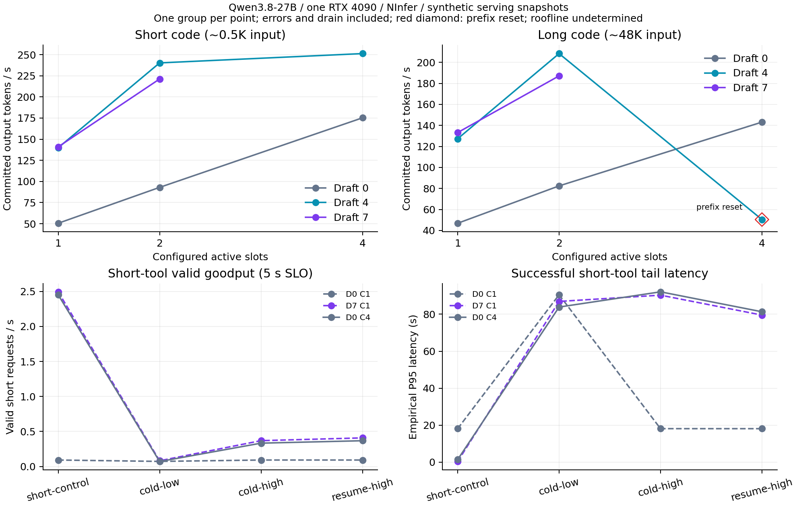

# 单4090长上下文、并发与MTP：验证结果

最明确的系统瓶颈是长预填充期间对新短请求的准入阻塞。4个并发槽、2048-token预填充块仍不能保证后到短请求及时开始；源码与原生调度计数支持这个解释。严格的decode带宽饱和结论仍是**undetermined**，异构MTP批量的额外可消除浪费也尚未得到因果验证。

本轮使用同一27B模型和NInfer二进制，输入提高到48K/96K/192K、128K长短混合与248K近上限探针。原18081服务已恢复为256K、MTP7、C1，客户端配置继续沿用；恢复后的PID为2925627。GPU0的PID2504785与18080服务保持健康。

## 实际完成范围

预先冻结12个配置、107个性能组、2528条请求。其中10个配置完成、2个在请求提交前启动失败，最终得到89个性能组、1973条实际请求；555条计划请求未提交，不能算作HTTP错误或完成样本。实际请求1544条协议成功、429条错误（全部HTTP429）；269次warmup全部协议成功。840次成功工具调用的名称和参数正确，没有协议成功但工具参数不符的样本；704条代码/说明性能输出按192token截断，不计质量通过。9次独立代码验证通过，未构成完整公开Benchmark或MTP等价性验证。

每个性能点只有一个独立组，组内多个请求受共享模型、前缀与调度状态影响；没有独立重复、随机交错配置或置信区间。结果用于定位瓶颈，不能给出总体P95/P99保证。

| 配置 | 状态 | 性能组（实际/计划） | 请求（实际/计划） |
| --- | --- | ---: | ---: |
| d0-c1 | completed | 13/13 | 479/479 |
| d4-c1 | completed | 9/9 | 92/92 |
| d7-c1 | completed | 13/13 | 479/479 |
| d0-c2 | completed | 9/9 | 92/92 |
| d4-c2 | completed | 9/9 | 92/92 |
| d7-c2 | completed | 9/9 | 92/92 |
| d0-c4 | completed | 11/11 | 471/471 |
| d4-c4 | completed | 7/7 | 84/84 |
| d7-c4 | infrastructure_error | 0/11 | 0/471 |
| d0-c8 | completed | 7/7 | 84/84 |
| d7-c8 | infrastructure_error | 0/7 | 0/84 |
| d7-c1-near256 | completed | 2/2 | 8/8 |

D7/C4的engine runtime reservation需要6977052672B，可用预算6949583872B，超出27468800B（约26.2MiB）；D7/C8需要8115939072B，超出约1.09GiB。这里是引擎显存预留检查失败，未发生请求推理；保持冻结配置，不用更小KV预算悄悄替代失败点。C4/MTP7的性能、干扰与质量结果因此缺失。

## 纯生成与长输入

下表单位为 committed output token/s，分母包括完整测量组和排空。D表示MTP draft窗口，D0为非投机；C表示配置的active槽上限，不是实际批量恒定值。每类短请求n=12。

| 配置 | 启动显存 used/free MiB | 0.5K代码 | 0.5K说明 | 0.5K工具 |
| --- | --- | ---: | ---: | ---: |
| d0-c1 | 20917/3191 | 50.54 | 50.53 | 49.85 |
| d4-c1 | 21925/2183 | 139.84 | 87.93 | 151.06 |
| d7-c1 | 21935/2173 | 140.91 | 82.16 | 192.86 |
| d0-c2 | 21221/2887 | 92.99 | 93.01 | 89.43 |
| d4-c2 | 22237/1871 | 240.23 | 158.61 | 240.72 |
| d7-c2 | 22257/1851 | 221.20 | 128.26 | 271.56 |
| d0-c4 | 21827/2281 | 175.24 | 175.31 | 161.30 |
| d4-c4 | 22869/1239 | 251.24 | 164.49 | 264.10 |
| d7-c4 | 启动失败 | — | — | — |

48K代码/说明各n=8；同长混合、短代码+容量说明各n=16。容量说明在C1约192K、C2约96K、C4约48K，不能作为同一输入的并发扩展曲线。†表示测量组出现完整前缀重算，仍保留整个组的吞吐，不能当成纯warm decode样本。

| 配置 | 48K代码 | 48K说明 | 同长混合 | 短代码+容量说明 | 混合实际batch |
| --- | ---: | ---: | ---: | ---: | ---: |
| d0-c1 | 46.86 | 46.86 | 27.32† | 14.78† | 1.00 |
| d4-c1 | 127.29 | 81.19 | 39.81† | 17.84† | 1.00 |
| d7-c1 | 133.19 | 75.07 | 38.39† | 17.37† | 1.00 |
| d0-c2 | 82.43 | 82.41 | 82.69 | 82.55 | 1.99 |
| d4-c2 | 208.38 | 134.54 | 145.02 | 141.41† | 1.61 |
| d7-c2 | 187.15 | 108.32 | 119.28 | 121.03† | 1.53 |
| d0-c4 | 143.15 | 143.10 | 144.24 | 157.50 | 3.95 |
| d4-c4 | 50.40† | 143.01 | 175.58 | 178.28 | 3.22 |
| d7-c4 | 未提交 | — | — | — | — |

D4/C4的48K代码组有一次full reset，总computed_prefill=49152、该次prefill约23.56秒，导致组吞吐50.40；同组其余7条走restore。C1两类混合各含两次full reset，同长混合总重算98307、短长混合197150token。这些数据不足以证明MTP批量验证本身出现浪费。

独立容量层次：D0/C8使用128K总KV预算，启动显存21681/2427MiB；0.5K代码/说明约252.00/252.16token/s，15K代码/说明约278.29/278.39，同长混合284.54、短长混合301.69。D7/C8未启动，不能对比MTP收益。D7/C1近256K探针使用256K总KV预算，代码实际253932token、说明253935token，各4条测量全部成功，吞吐92.31/53.70token/s。代码首次冷prefill201.18秒，说明首次冷prefill见原始warmup日志；启动显存22801/1307MiB；后续每次实际复用prompt减4token。近上限探针仅验证可运行与性能，不验证长文本理解质量或任意多个248K会话容量。

图中的红色菱形标记完整前缀重算；未启动配置没有测量点。下方曲线中的控制/低负载/高负载/续接波次必须结合拒绝率和长请求是否被接纳阅读。[SVG](../../results/concurrency/concurrency.svg) / [PDF](../../results/concurrency/concurrency.pdf)。

## 长预填充与短调用SLO

短调用带24K固定历史，长调用约128K。control、cold-high和resume-high短到达率2.5RPS；cold-low为0.5RPS。48秒内按固定到达时间提交，长请求于16秒到达；波次时间包含排空。下表短调用的协议成功均同时通过工具参数检查。分位数只统计成功请求，错误和SLO达成数同时保留，避免拒绝请求让尾延迟看起来更好。

| 配置 / 波次 | 短请求成功/提交 | 短请求错误 | 成功短P95秒 | 成功短P99秒 | 5秒内有效短调用 | 5秒goodput /s | 长请求cached/new |
| --- | ---: | ---: | ---: | ---: | ---: | ---: | --- |
| d0-c1 short-control | 61/120 | 59 | 18.09 | — | 6 | 0.09 | 无长请求 |
| d0-c1 cold-low | 24/24 | 0 | 90.55 | — | 9 | 0.07 | 0/131046 |
| d0-c1 cold-high | 61/120 | 59 | 18.11 | — | 6 | 0.09 | 拒绝，未完成推理 |
| d0-c1 resume-high | 61/120 | 59 | 18.10 | — | 6 | 0.09 | 拒绝，未完成推理 |
| d7-c1 short-control | 120/120 | 0 | 0.34 | 0.34 | 120 | 2.49 | 无长请求 |
| d7-c1 cold-low | 24/24 | 0 | 86.93 | — | 9 | 0.08 | 0/131046 |
| d7-c1 cold-high | 57/120 | 63 | 90.32 | — | 41 | 0.37 | 0/131046 |
| d7-c1 resume-high | 57/120 | 63 | 79.54 | — | 41 | 0.41 | 24554/106481 |
| d0-c4 short-control | 120/120 | 0 | 1.38 | 1.38 | 120 | 2.45 | 无长请求 |
| d0-c4 cold-low | 24/24 | 0 | 83.89 | — | 8 | 0.07 | 0/131046 |
| d0-c4 cold-high | 58/120 | 62 | 92.12 | — | 38 | 0.33 | 0/131046 |
| d0-c4 resume-high | 58/120 | 62 | 81.34 | — | 38 | 0.37 | 24554/106481 |

D0/C1在没有长请求的2.5RPS控制组已过载；其cold-high/resume-high中的长请求都被拒绝，因此这些组只提供准入结果，不能拿来比较长prefill成本。低负载组的长请求均实际完成，且无短请求拒绝，但短调用P95仍达到约84–91秒。

D0/C4控制组120/120成功、P95约1.38秒；长冷请求与真实续接请求都进入推理后，各波次短请求仅58/120成功、62次429，P95分别约92.12/81.34秒。短调用5秒有效goodput从2.45/s降至0.33/0.37/s。真实续接命中24554token，重算106481token，相比冷请求131046token降低预填充量，仍未消除阻塞。长请求后还各有一个短请求失去24K前缀，总短请求重算24786token；这部分额外成本也属于波次结果。

固定源码[concurrent_executor.h:1197–1208](https://github.com/UDPSendToFailed/ninfer-4090/blob/5c60b7c9b455231795c09da21a9fbb6aa53f08e5/src/runtime/engine/concurrent_executor.h#L1197)在`prefill_lane_`存在时交替运行已有decode成员和prefill块，然后continue，新准入在后续分支。这解释了“已有decode能轮转，后到短请求仍排队”的区别。D0/C4冷高负载原生日志中有90个一秒采样点同时存在prefill和等待，其中65点active请求少于4、25点只有长prefill而无decode；续接对应80/53/8点。它们是相关的周期采样，不能把采样数当独立重复或GPU空闲时间。详细计数与固定源码哈希见[source-evidence.json](../../results/concurrency/source-evidence.json)。本轮没有修改引擎或做准入机制消融，不声称这一分支解释了全部成本。

## Roofline与独立trace

GPU1 D2D拷贝读写总带宽中位数921.29GB/s。驱动配置`RmProfilingAdminOnly:1`，没有推理kernel的实际DRAM字节计数，不能用拷贝参考、配置批量或memory-controller utilization证明模型已达到带宽roofline。

两个独立profiler尝试都失败且不进入性能聚合。D0/C1服务达到healthy后被包装器进程归属检查拒绝，错误`GPU1 process ownership ambiguous`；留存500395B `.nsys-rep`和SQLite、stats导出返回0，但没有CUDA kernel数据表、没有profile measurement，不能把“有文件”称为有效推理trace。包装器归属检查使用PGID相等，退出后的记录不足以重建精确PGID差异。D7/C4因同样显存预算检查失败，报告文件缺失。没有有效kernel timeline时，无法据此估计host/launch空隙，更不能给出直接带宽饱和结论。错误与文件哈希都保留在[summary.json](../../results/concurrency/summary.json)及HDD原始目录。

## 研究判断

本轮最明确的问题是**长预填充对后到短请求的准入阻塞**。D0/C4 短请求控制组120/120成功，成功样本P95约1.38秒；加入一个实际完成的128K冷请求后，短请求58/120成功、62条HTTP429、成功样本P95约92.12秒。续接长请求确实命中24554token，只重算106481token，但同波次仍有62条429，短请求成功样本P95约81.34秒。减掉24K预填充改善了总波次时间，未消除阻塞。

这不是只看token/s得到的推测。固定engine源码 `src/runtime/engine/concurrent_executor.h:1197` 在存在 `prefill_lane_` 时让已有decode成员与prefill块交替，并在分支末尾continue；新准入在后面的1208行。因此配置2048-token chunk和4个active槽并不意味着一个长prefill期间可以接入后来的短请求。这个源码事实支持准入门控作为主要解释，但本轮未修改引擎做消融，也未证明所有延迟均由这一处引起；短前缀失效产生的约24K额外重算也要单独报告。

**MTP的最佳窗口取决于输出类别、上下文与并发。** C1/48K代码D7约133.19t/s，比D4约127.29稍高；同上下文说明文本D7约75.07，反而低于D4约81.19。到C2代码D4约208.38、D7约187.15，说明D4约134.54、D7约108.32。单点差异没有独立重复；这是调优信号，不是自适应window机制的创新证据。

**目前还不能认定异构MTP batch存在额外可消除的验证浪费。** D0/C2同长代码、说明和混合约82.43/82.41/82.69t/s，实际batch约1.99，各组仅重算每请求4token，未观察到普遍异构惩罚。D4/C2混合约145.02、D7/C2约119.28，同时实际batch降到1.62/1.53；快producer提前结束，慢producer继续，有限请求尾部会降低平均batch。将混合吞吐与两个uniform的简单平均比较无法把尾部效应和验证浪费分开。C1混合组还含两次完整重算，D4/C4 uniform代码也出现一次48K重算，均不宜称为纯decode对照。

**严格roofline结论为undetermined。** GPU1 D2D读写总带宽中位数约921.29GB/s，只是拷贝参考；没有推理kernel的实际DRAM字节计数。memory-controller utilization是活动时间百分比。长冷输入还包含显著预填充，不能用纯decode带宽上限解释整个波次；本轮用实际准入、前缀计数、时间和失败率指出了额外服务瓶颈。

企业场景可具体到：多个本地代码agent共享一张24GB GPU，一些会话刚结束工具操作、需要追加长仓库/工具输出，另一些会话正在提交短状态工具调用，要求短请求在明确SLO内完成。评估目标应是给定长请求工作量下的短请求有效goodput、长请求进展和拒绝率，而非单一token/s。输入248K可放下与多会话交互稳定是两项不同能力；本轮数据不能替代真实agent轨迹的分布验证。

直接“增加chunking/提高concurrency/自适应draft/分离prefill和decode”已有相关工作。下一阶段应先建立能在长预填充期间接入短续接的强基线，并检查当前staged-prefill单owner约束需要怎样安全地暂停/恢复；已有chunk轮转/动态budget应作为对照；若短SLO仍与MTP验证、长上下文状态占用耦合，才研究在固定24GB显存下联合选择准入和验证预算的剩余问题。尚未证实残余成本，不能现在定题为新机制，也不需要强行引入DRAM/SSD三级卸载或手动KV管理。

## 设置和计量方法

只使用 GPU1 的一张 RTX4090；GPU0 原服务不参与生成。固定 Qwen3.8-27B 的既有 NInfer artifact、量化及贪心无思考设置，固定 engine commit `5c60b7c9b455231795c09da21a9fbb6aa53f08e5`；不修改推理引擎、驱动、时钟/功率、全局环境或客户端配置。数据全部在 HDD 根目录 `/home/guokc/mypro/gnn-mount-sda1/InferX`。

主网格为 draft0/4/7 × C1/2/4，总 KV token 预算212,992，预填充块2048，启动后剩余显存至少1024MiB。`max-context` 实际设为 `min(262144, pooledKV)`；这与模型原服务的262144单请求窗口是不同的限制。C8 使用131072 pooledKV、约15K历史；近256K探针使用262144 pooledKV、单请求约248K输入。这两组单独报告。

同长度对照采用48Ki token历史。容量对照分别为C1≈192Ki、C2≈96Ki、C4≈48Ki、C8≈15Ki；容量对照中的输入长度不同，不能当成相同任务的并发扩展曲线。GPU0只调用CPU模板/tokenizer接口用于预先定长，实际长度以NInfer usage为准。代码/说明负载的输出上限192token，工具调用128token；这些输出限制用于测性能，截断代码/说明不是质量通过。每个普通配置另用1024输出预算运行一次独立merge-intervals验证，正确工具参数单独计数；它们不构成完整精度Benchmark。

异构闭环负载在C>1时保持每个producer只有一个未完成请求，各producer独立推进，同一producer保持相同历史/任务类型。C1按类型串行排列作为对照。相同历史但更换最后一条问题，会跨越当前NInfer保留的checkpoint边界，因此C1混合组仍可能出现少量完整重算；必须查看实际cached/computed_prefill计数。不能把这部分时间归因于批量MTP验证。

长短混合流量在D0/D7、C1/C4运行四个独立48秒波次：24K历史短工具请求控制组2.5RPS；128K冷请求与0.5RPS短请求；128K冷请求与2.5RPS短请求；128K真实续接请求与2.5RPS短请求。混合组只有一个长请求，于16秒到达。续接模板包含完整seed用户请求、assistant工具调用和tool结果，冷对照只改变首部system nonce。单独核查长请求是否实际复用约24K，以及短请求是否因长请求而丢失复用。

客户端使用开放式到达，不等待前一请求完成后才安排下一请求；dispatch lag计入arrival latency。服务配置`max-pending-requests=16`、600秒队列时限；该版本实际以`C+16`限制全部未完成请求，等待数可超过16（C4观测到17）。客户端总时限900秒。全部错误、过载、超时、功能失败和排空时间保留。吞吐的分母含完整波次和排空；有效工具goodput必须同时满足协议、参数和指定0.5/1/2/5/10秒SLO。P95只有成功样本≥20时报告，P99需≥100；它们是单波次经验分位数，不是总体保证。错误率和有效goodput必须与成功请求分位数一起读取。

CPU prepare/prefill/decode/TTFT计时来自原生日志，可能含重叠/排队；不能求和后称为GPU执行时间。各类native计数只在不同类别的实际prompt-token大小不交叉、且native完成数与客户端成功数一致时关联；不能由HTTP流的随机id臆造原生request_id。

## 带宽和 profiler 的解释

独立CUDA D2D拷贝使用两个256MiB缓冲区，8次预热、每样本64次copy、5个样本，计算读取加写入共`2×payload`的GB/s。它测的是拷贝带宽，不是模型权重/状态的实际DRAM流量。`nvidia-smi`的memory-controller utilization也不是GB/s，官方定义为采样期间全局显存读写所占的时间比例，见[NVIDIA文档](https://docs.nvidia.com/deploy/nvidia-smi/index.html)。

驱动的`RmProfilingAdminOnly:1`限制硬件counter访问，本轮不改权限。Nsight Systems的代表性运行与所有性能组分开，保留CUDA kernel/API摘要及可用的SQLite。kernel时间求区间并集，另列逐kernel duration的总和；trace包含warmup，kernel-envelope里的无kernel区间也可能有copy，不能自动叫GPU空闲。没有有效的推理kernel DRAM counter时，严格的带宽饱和结论应为undetermined；曲线接近带宽上限只是相容证据。

## 诊断批次与修正

v2先完成五个性能组，并采到11/16个48K混合请求。该组更换末尾问题时，每次完整重算约49K，首次prefill约23.5秒。源码显示保留的turn checkpoint在最后用户问题之后；v2续接模板省去了这条问题，因此其128K“resume”控制先验无效。通过受控中断，原256K服务恢复为PID2868383、两份manifest一致、GPU0健康。全部v2原始数据保存在HDD `concurrency-roofline-v2-prefix-diagnostic`，排除理由见 `results/concurrency/v2-diagnostic-exclusion.json`，不混入v3主结果。

v3保留完整seed query与工具回复。独立语义预检查中，607token续接成功复用508token，只重算99token，功能参数正确。这个短预检查验证协议及checkpoint语义，不是长输入性能样本；主实验仍按48K/96K/192K/128K混合和248K探针重新运行。

## 复现

冻结grid与workload哈希在`results/concurrency/`；完整payload、每个请求的原始SSE、原生日志、telemetry及profiler留在HDD。工作目录是HDD `code-tuning`，source `$INFERX_ROOT/env.sh`后用`repo-venv/bin/python -m scripts.analyze_concurrency "$INFERX_ROOT/concurrency-roofline" <output>`导出；重复导出只读明确的raw输入，不递归读取derived输出。`--allow-running`仅用于进度观察，终版禁止混入运行中的状态。

完整campaign需要核对原18081服务的PID、UID、executable、startticks、GPU和idle状态；控制器通过pidfd停已核对服务，用finally恢复原配置并刷新两份manifest。不能用killall或按端口盲杀。`--restore-only`是GPU1空闲且原控制器已退出时的恢复入口，不能与活跃campaign或已恢复实例并用。源码和冻结记录不适合覆写后复跑：新一轮需独立目录或明确归档现有目录。

## 研究边界：2026-10-14 核对的相关工作

这些是原论文或项目文档报告的结论，不能直接外推到本轮 27B/4090/C≤8 设置。

| 工作 | 已覆盖的方向 | 本轮需要避免的重复 |
| --- | --- | --- |
| [BASS](https://arxiv.org/abs/2404.15778)，2024 | 批量 speculative decoding 的延迟和吞吐优化 | “把 MTP 和 batching 结合”本身已有工作 |
| [AgentServe](https://arxiv.org/abs/2603.10342)，2026-03 | 消费级 GPU 的 agent 服务与算法/系统协同 | 长短请求的资源调度不能仅换成 agent 场景就称为创新 |
| [ASPIRE](https://arxiv.org/abs/2609.17943)，2026-09-16 | 长上下文的异步批量 self-speculation，按请求决定验证时机 | 异步 draft/verify 和自适应 draft 长度已有直接相关机制；其稀疏 attention draft 与本模型 MTP 也有区别 |
| [TreeWY](https://arxiv.org/abs/2608.20961)，2026-08-21 | GDN 投机验证，用紧凑表示替代逐候选完整 recurrent-state 快照 | 减少 GDN 回滚快照内存已有工作；“更宽树可放下”也不自动等于吞吐提升 |
| [ReplaySSM](https://arxiv.org/abs/2610.13778)，2026-10-09 | checkpoint 加近期输入缓冲，分离输出计算与状态更新，降低状态读写及回滚成本 | 状态 I/O 与投机回滚不能忽略这篇新工作；其 batch256/大模型结果不能当成本轮 C≤8 的收益 |
| [Sparse Prefix Caching](https://arxiv.org/abs/2605.05219)，2026-04-17 | 按共享前缀重叠深度放置 recurrent-state checkpoint | 本轮观察到的 checkpoint 边界失效是诊断证据，不能直接包装成新缓存策略 |
| [Native Dual Pools or Shared Paging?](https://arxiv.org/abs/2610.15755)，2026-10-11 | 混合模型 attention/recurrent/convolution 状态的存储布局、准入与保留时间比较 | 最新相关工作也在研究内存组织和 checkpoint 生命周期；摘要明确保留续接正确性尚未解决 |

下一步只有在本轮控制成立、额外损失稳定出现，而且能通过这些方法的对照或消融定位剩余成本时，才值得进入机制设计。单卡移植、更长输入、固定参数调优都属于实验条件和工程工作。

## 交付与核验

- 完整原始请求/SSE、warmup、native JSONL、GPU telemetry、服务器日志和profiler文件：HDD `concurrency-roofline/`。无新模型下载。
- 轻量记录：[summary.json](../../results/concurrency/summary.json)、[groups.csv](../../results/concurrency/groups.csv)、[requests.csv](../../results/concurrency/requests.csv)、[audit.json](../../results/concurrency/audit.json)、[冻结grid](../../results/concurrency/grid.json)、[workload哈希](../../results/concurrency/workload-manifest.json)。实际89组的客户端成功数均与native request_done一致，全部工具分类由raw SSE重新核查，无分类修正。
- 两次只读raw导出的summary/groups/requests哈希一致，仓库副本也匹配，见[export-audit.json](../../results/concurrency/export-audit.json)。未混入v2或profiler请求。
- [恢复核验](../../results/concurrency/restoration-audit.json)：实际PID/executable/startticks核对，两份manifest一致，原argv与所有客户端预算保持，窗口262144，原服务idle，OpenAI与Anthropic强制工具调用的名称/参数/结束状态通过，GPU0身份与health保持。

代码完整验证命令为`ssh vlm-server 'source /home/guokc/mypro/gnn-mount-sda1/InferX/env.sh; cd "$INFERX_ROOT/code-tuning"; "$INFERX_ROOT/repo-venv/bin/python" -m pytest -q'`。本轮107项完整测试通过；测试与执行裁决记录将在最终代码复审后归档，数据与引擎保持独立。
