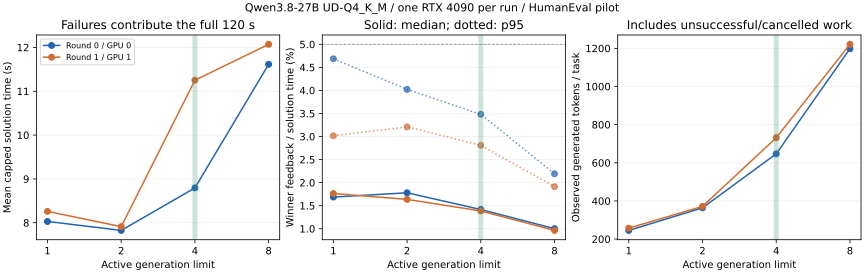

# Qwen3.8-27B 单卡部署与生成—验证筛查

单卡部署成功，两轮共 512 次预定试验已完成。当前 HumanEval workload 不支持“CPU 验证反压是主要瓶颈”的假设：开发集选定宽度 4 后，两轮验证反馈占比中位数仅 1.42% / 1.38%。更明显的现象是提高候选并发增加生成成本，却未改善评估集的解决时间。这个结果用于筛选课题，尚不构成新机制或论文贡献。

## 已验证的部署

Qwen3.8-27B 的 UD-Q4_K_M 文本推理已在 vlm-server 的单张 RTX 4090 上运行。两张卡各运行独立模型副本，分别承担一轮采样；没有使用双卡张量并行。

| 项目 | 配置或实测 |
| --- | --- |
| 模型 | `unsloth/Qwen3.8-27B-GGUF/Qwen3.8-27B-UD-Q4_K_M.gguf` |
| 文件 | 16,464,440,224 字节，约 15.33 GiB；完整 LFS SHA256 校验通过 |
| 模型 revision | `4ca720788d1e01f1bff70c033e0d0028fd02e502` |
| SHA256 | `322e194ff79741c7baa497c240f677f54b201b0efab44ca8e50f122b39123482` |
| 引擎 | llama.cpp v0.6.0，源码 commit `d81235049384534c167caea52b85a694f6103d14` |
| 构建与运行时 | CUDA 12.6、SM89、GNU 13.3.0；运行时版本检查为 12060 |
| 实验服务 | GPU 0：`127.0.0.1:18080`；GPU 1：`127.0.0.1:18081`，各自独立单卡 |
| 并发与上下文 | 8 slots，每槽 2048 token，总上下文 16384；Flash Attention；f16 KV |
| 生成模式 | thinking 关闭，MTP speculative decoding 未启用；只测文本能力 |
| 冒烟 | API 回复 `OK`；2 道代码题 × 并发 1/2，共 4 次均通过给定测试 |
| 取消验证 | 每卡 8 个流均已输出 token 后同时取消；两卡分别约 0.092/0.064 秒恢复全部槽位空闲（最终 HTTP 配置） |

模型属于 dense，但混合使用 Gated DeltaNet 与全注意力，因此同时需要 attention KV 和 recurrent state。[官方结构说明](https://huggingface.co/Qwen/Qwen3.8-27B)

详细启动日志报告 `66/66 layers` GPU offload；分配如下。层数日志含转换后的模型结构，官方语言模型主干为 64 层；日志同时提示未启用的 MTP 张量被忽略。

| 缓冲区 | MiB |
| --- | ---: |
| CUDA 模型权重 | 14674.45 |
| CPU mapped 模型缓冲（embedding） | 682.03 |
| CUDA attention KV | 1024.00 |
| CUDA recurrent state | 1197.00 |
| CUDA 计算工作区 | 144.02 |
| CUDA host 计算工作区 | 42.02 |

正式运行期间每秒采样，GPU 0 / 1 分别采到 2513 / 2678 个点，显存观测峰值为 **17561 / 17569 MiB，约 17.15 / 17.16 GiB**，最高温度 78 / 74°C；每轮约 41.94 / 44.70 分钟。未发生 OOM，1 秒采样不保证捕捉所有瞬时峰值。宽度 1 评估记录中，完整候选的引擎 decode 速率中位数为 44.62 token/s；包含提示处理、测试和清理的端到端观察吞吐见后表。

这里的 CPU mapped 缓冲应与 GPU 分配一起报告，不能将“全层 offload”写成所有权重和工作区都只占 GPU 内存。本次运行没有采用逐层 CPU/SSD 权重卸载，也没有测 HDD 冷启动时间。[资源统计](../../results/pilot/resources.json)、[正式时段采样](../../results/pilot/gpu-telemetry.csv)、[启动内存日志摘录](../../results/pilot/startup-memory-excerpt.txt)可直接复核。

## 实验问题与协议

验证的问题是：单卡代码候选生成配合 CPU 执行测试时，在异步验证和成功即取消的固定并发基线下，验证反馈是否仍造成稳定、显著的关键路径等待。这个问题的正反结果都可接受。

- HumanEval 固定 revision `7dce6050a7d6d172f3cc5c32aa97f52fa1a2e544`，用 seed 20261014 划分 16 道开发题、48 道评估题，剩余 100 道保留。题目选择发生在模型生成前。
- 4 个并发宽度：1、2、4、8；宽度只限制活跃生成。生成结束即异步验证并补充候选，验证通过即取消其余工作。单题候选上限 8，期限 120 秒。
- temperature 0.8、top_p 0.95、top_k 0、min_p 0、max_tokens 768。原始测试和参考答案不进入生成提示。最长输入 470 token，输入加输出上限均在每槽 2048 token 内。
- 两轮采样 seed 不同；同一轮内同题同候选号 seed 相同。批处理数值和缓存历史可能影响实际输出，不假定各策略生成文本完全一致。
- 开发集按通过题数优先、其次平均截断解决时间选择宽度；评估集报告锁定宽度及全部基线。未通过题按 120 秒计入该时间指标，同时单独报告实际服务耗时。
- 每轮两个验证进程，分别固定 CPU 8/9 或 36/37；引擎与客户端分别使用 CPU 0–7 或 28–35。机器本身为双 Xeon Gold 6348、约 503 GiB 内存，不能当作普通桌面内存配置的实证。
- 每次取消后查询服务端 slots，确认全部空闲再开始下一题。报告已观察 token 数的下界，服务端取消后的清理耗时另外计入实际 wall time。
- 保留相同的引擎缓存设置和随机试验顺序；没有强制每次清空前缀缓存。本轮是应用端固定并发筛查，尚未比较所有引擎及缓存策略。

验证器使用独立 Python 进程、CPU/地址空间/输出限制及 seccomp allowlist，禁止文件打开、网络、fork/exec 等系统调用；安装过滤器失败会中止试验。它面向公开基准中非对抗性的模型输出，允许预加载的标准库，不是通用恶意代码执行服务。选定 64 道题的参考答案全部通过环境检查。

独立 CPU 校准：两个验证核处理 64 个参考答案用时 2.792 秒，约 22.919 题/秒；进程总耗时中位数 86.77 ms，测试执行中位数 5.432 ms。该校准不包含 GPU 生成，不能代替端到端结果。

## 完整结果

正式批次 `qwen38-v2-r0` 和 `qwen38-v2-r1` 均正常退出，各 256 条。结果通过 16 道开发题 / 48 道评估题 × 4 宽度 × 2 轮的完整网格检查，没有重复试验或开发/评估题目重叠。运行代码固定于 `0a0b2d6`，每轮保留六个运行时源码文件的 SHA256；分析器增加了“取消前已经等待的验证请求也计入队列统计”的修正，不改变运行代码或判定阈值。

开发集两轮合并后，宽度 1/2/4/8 分别通过 27/28/29/29 次（各 32 次）。宽度 4 和 8 通过数相同，平均截断解决时间分别为 20.94 / 22.55 秒，因此按预定规则选择 **宽度 4**。下表是独立评估集，两轮合计各 96 次；这不是 96 道不同题目。

| 活跃生成宽度 | 通过次数 | 平均截断解决时间，秒 | 观察 token / 题 | 未用作获胜答案的 token 占比 | 观察 token / 实际服务秒 |
| ---: | ---: | ---: | ---: | ---: | ---: |
| 1 | 94/96 | 8.14 | 251.4 | 16.56% | 38.25 |
| 2 | 94/96 | 7.87 | 367.7 | 54.34% | 60.33 |
| **4（开发集选定）** | **93/96** | **10.02** | **689.1** | **78.53%** | **90.77** |
| 8 | 94/96 | 11.84 | 1209.5 | 87.81% | 124.39 |

失败按 120 秒计入第三列；最后一列的分母使用实际服务时间并包含服务端清理。未用作获胜答案的 token 包括失败、被取消和其他未选候选，不能全部等同于可无损省掉的浪费。观察 token 是下界，尤其宽度 1 被取消请求可能尚未向客户端送出 token，但仍有 GPU 清理成本。

宽度 4 相比宽度 1，平均截断解决时间增加 **1.88 秒（23.08%）**，token 增至 **2.74 倍**；通过数少 1 次。对 48 道题进行配对 task-cluster bootstrap，保留每题两轮，2000 次重采样：时间差的 95% 区间为 **[0.12, 4.48] 秒**，通过率差为 **−1.04 个百分点，95% 区间 [−3.125, 0] 个百分点**。该区间只反映此任务样本和两轮的变动，不能代表其他模型、引擎或 GPU 的不确定性。宽度 2 在评估表中耗时更小属于事后描述，本轮没有据此重新选择策略。

选定宽度的反馈压力分别为：

| 指标 | 第 0 轮 / GPU 0 | 第 1 轮 / GPU 1 |
| --- | ---: | ---: |
| 通过次数 | 47/48 | 46/48 |
| 获胜候选反馈占比，中位数 | 1.416% | 1.385% |
| 获胜候选反馈占比，p95 | 3.481% | 2.809% |
| 验证排队 p95 | 76.18 ms | 75.60 ms |
| 验证槽位平均占用率 | 0.914% | 0.847% |
| 服务端清理 p95 | 752.81 ms | 626.87 ms |

两轮都满足预定的否定门槛，因此本轮**不实现验证反压策略**。宽度 4 的验证进程耗时中位数约 84.04 ms，真正执行测试的中位数约 5.09 ms；CPU 验证能力大部分时间闲置。服务端取消清理的 p95 高于验证开销，已单独计入实际服务时间，值得后续分解，但不能仅凭 p95 就认定它是整体主瓶颈。

全部 512 次中 488 次通过、21 次耗尽候选预算、3 次到达期限。2537 个候选中，233 个完成验证后失败：120 个 AssertionError，113 个 SyntaxError；所有 SyntaxError 均出现在触及 768 token 输出限制的候选上。没有验证器超时，也没有导入/权限限制错误。选定宽度的三次评估失败是 HumanEval/145 两轮及 HumanEval/32 第 1 轮，均为预算耗尽。保留所有这些失败，不临时放宽输出上限。[诊断记录](../../results/pilot/diagnostics.json)



可下载 [SVG 图](../../results/pilot/overview.svg)、[CSV 汇总](../../results/pilot/summary.csv)、[JSON 汇总与置信区间](../../results/pilot/summary.json)、[512 条逐题事件记录](../../results/pilot/trials.jsonl)和[配置、版本、原始记录哈希](../../results/pilot/provenance.json)。原始生成文本留在远端 HDD，轻量记录保留候选代码哈希。

早先两次批次 `qwen38-r0` / `qwen38-r1` 分别留下 15/43 条记录，已排除。前者出现 HTTP POST 连接断开，模型进程仍正常存活；后者为保持协议一致而主动中止。客户端增加“不复用连接”的配置，回归测试复现同类关闭连接问题并通过修复，未对生成 POST 增加可能重复计算的重试。两张卡重启服务、清空先前缓存历史后重跑。

## 解释边界与选题门槛

核心反馈比例为获胜候选的 `(验证结束 - 生成结束) / 首次通过时间`，包括排队、进程启动和执行。不能用所有并行验证时间之和替代关键路径。按预先写定规则，两轮中位数都低于 5%、p95 都低于 10%、验证排队 p95 都低于 0.1 秒，才判定当前 workload 未呈现显著验证压力；任一轮成功题不足 12 则证据不足。两轮中位数都达到 10% 时，才进入最小反压策略对照。阈值用于选题筛查，不代表统计显著性或论文录用条件。

排队指标包含取消前已经等待的候选，按入队到开始服务或发出取消请求的时间计算，并另外报告未开始服务就取消的数量；这些等待相对于最终可服务时间是删失观测，不能解释成它们本来无需等待。

当前实验没有覆盖仓库级构建/测试、多轮修复、多租户到达、长上下文或多模态，也未比较原始精度与量化版本的质量差异。HumanEval 原始测试的通过不等于程序被证明正确。768 token 输出上限、关闭 thinking 和有限标准库环境均属于结果适用条件。

轮次与物理 GPU 一一对应，因此本轮不能单独分离采样 seed 与卡间差异。16 道开发题的策略选择没有稳定推广到 48 道评估题，也说明下一步需要更大的开发集和更多独立采样轮次。

动态生成/验证预算已有 [Adaptive Generate–Rank–Verify](https://arxiv.org/abs/2605.17609)；工具重叠和沙箱预热分别已有 [PASTE](https://arxiv.org/abs/2603.18897) 与 [SpecBox](https://arxiv.org/abs/2607.23933)。混合模型缓存还需要对照 [SGLang Unified Radix Cache](https://www.sglang.io/blog/unified-radix-cache) 和 [SuffixReplay](https://arxiv.org/abs/2609.33477)。本轮部署与脚本本身不作为新机制；后续课题必须给出这些策略仍解决不好的具体证据。更详细的对照见[设计说明](../superpowers/specs/2026-10-14-feedback-validation-design.md)。

## 下一步选题建议

目前不建议继续围绕 HumanEval 的 CPU 验证排队设计复杂机制。更值得验证的是**企业代码 Agent 在单卡上进行多个候选分支搜索时，有限推理预算如何在不同任务和分支之间分配**：本轮已看到批量 token 吞吐上升而任务解决时间变差，但这还只是现象，普通的自适应预算已有相关工作。

下一轮应使用真实仓库构建/测试和多会话到达，让任务长度、通过概率、工具返回时间自然变化，测量固定宽度、已有动态预算和引擎默认批处理分别何时失效。重点观察：并发候选挤占其他会话的响应期限、反馈返回后仍在运行的多余分支、暂停/恢复混合模型状态的真实成本。先分解这些开销，再决定是否需要联合控制候选并发、取消和会话状态保留；不预设必须使用 DRAM/SSD 卸载。

有发表潜力的门槛应是：在充分调优的现有策略下，多个真实工作流都出现相同瓶颈，并能用一个明确机制在质量相当时改善端到端延迟、资源成本或期限内完成率。当前结果只支持继续测“生成预算与分支成本”，不能宣称这一方向已具备新颖性，更不能据此判断 DAC 可录用。

## 复现入口

所有远端大文件在 HDD：`/home/guokc/mypro/gnn-mount-sda1/InferX`。模型/数据经 hf-mirror 获取，源码、Python 依赖使用各自的上游/软件镜像。脚本会检查 HDD 挂载，缓存和临时目录也放在该盘。

现有实验只读取 `/home/guokc/miniconda3/envs/llm/bin/python` 环境，没有修改它；下载器 hf_transfer 0.1.9 单独放在项目 `download-deps`。系统验证器使用 `/usr/bin/python3` 3.12.3。重建环境时可在 HDD 创建新 venv 并安装仓库的 `requirements-remote.txt`。

```bash
source /home/guokc/mypro/gnn-mount-sda1/InferX/env.sh
cd "$INFERX_ROOT/code"
bash scripts/build_llama.sh
/home/guokc/miniconda3/envs/llm/bin/python scripts/download.py
# 首次模型下载，hf_transfer 已安装在 download-deps：
PYTHONPATH="$INFERX_ROOT/download-deps" /home/guokc/miniconda3/envs/llm/bin/python scripts/prepare_27b.py
bash scripts/start_server.sh 0
```

另一个终端执行客户端，使用新的输出目录名：

```bash
source /home/guokc/mypro/gnn-mount-sda1/InferX/env.sh
cd "$INFERX_ROOT/code"
taskset -c 0-7 /home/guokc/miniconda3/envs/llm/bin/python scripts/run_pilot.py \
  --name repeat-r0 --gpu 0 --rounds 1 --round-offset 0 --verify-cpus 8,9
# GPU 1 先用 start_server.sh 1 启动，再单独运行另一轮：
taskset -c 28-35 /home/guokc/miniconda3/envs/llm/bin/python scripts/run_pilot.py \
  --name repeat-r1 --url http://127.0.0.1:18081 --gpu 1 \
  --rounds 1 --round-offset 1 --verify-cpus 36,37
/home/guokc/miniconda3/envs/llm/bin/python scripts/export_results.py \
  --runs repeat-r0 repeat-r1 --name repeat
/home/guokc/miniconda3/envs/llm/bin/python scripts/plot_results.py \
  "$INFERX_ROOT/exports/repeat/summary.json" "$INFERX_ROOT/exports/repeat/overview.svg"
```

服务提供 OpenAI 兼容的 `/v1/chat/completions`。从本机访问 GPU 0 可建立 `ssh -L 18080:127.0.0.1:18080 vlm-server` 隧道，再使用 `http://127.0.0.1:18080/v1`。

实验完成后保留 GPU 0 服务，健康检查正常、8 个槽位空闲；GPU 1 复验服务及遥测进程已停止。再次复现第二轮时需要重新启动 GPU 1 服务。后台服务没有配置为随系统重启自动启动。

## 验证与执行记录

远端完整测试 **25/25 通过**。独立只读复核覆盖调度、取消、验证隔离、统计和版本记录，未发现 Critical / Important / Minor 问题；另行核对远端两份原始结果哈希与导出记录一致、六个运行时源码哈希对应 `0a0b2d6`，并从本地 512 条事件重新生成完全一致的汇总及 bootstrap 区间。

代码、结果与报告保留于 `research/feedback-validation-pilot` 分支。准备过程的选型修订、CUDA 环境修复、HTTP 重跑原因、执行裁决及复核边界完整保存在[执行记录](2026-10-14-execution-record.md)。
