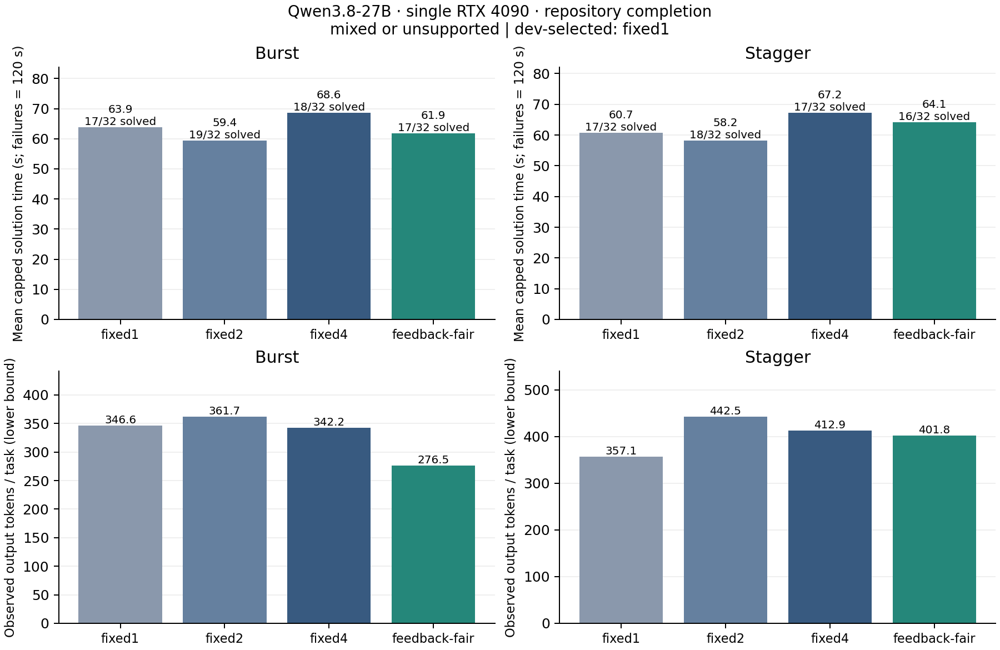

# 单卡 27B：仓库补全与多会话候选预算

正式实验已完成：48 次开发试验、64 个评估 episode，共 304 个任务结果。结论为 **mixed_or_unsupported**：当前数据没有形成稳定、显著且普通策略解决不好的瓶颈，不支持据此开发新调度机制。它也不能证明所有仓库代理场景都没有这类瓶颈。

## 本轮问题

上一轮 HumanEval 没有发现显著 CPU 验证压力。本轮把问题改为：真实仓库测试和多个用户同时请求时，过早生成候选是否浪费资源、增加解决时间；简单反馈门控与公平入队是否已经足够。普通策略有效时不宣称新机制，普通策略无效也必须排除低质量生成、环境失败和不完整样本。

场景是公开仓库的指定位置补全，不包含自主找文件、修改多文件或多轮修复。4 个会话的到达间隔人为设定，并非企业生产流量。企业相关性在于多用户竞争有限生成槽、验证结果延迟与可取消候选的预算管理；代表性仍需更广泛仓库和真实请求轨迹验证。

## 硬件与运行边界

- vlm-server 的 GPU 1：单张 RTX 4090；GPU 0 保留上一轮服务，不参与本轮两次重复。
- 模型为已经校验的 Qwen3.8-27B UD-Q4_K_M，llama.cpp v0.6.0，CUDA 12.6。8 slots × 8192 context，f16 KV，全部可 offload 层使用 GPU，未启用 CPU 权重卸载。启动显存 20593 MiB，评估阶段 1 秒采样峰值 20639 MiB，约 20.16 GiB；这不是双卡合并显存。
- 沿用该引擎默认的 8192 MiB RAM prompt cache，`cache_prompt=true`，episode 间不清空缓存。没有 CPU 权重卸载不代表没有宿主端 KV/prompt 状态；一次运行中宿主 RSS 采样约 11.58 GiB，不是单阶段峰值，也不包含其他进程或系统 page cache。跨 episode 的缓存历史是本轮限制，随机排序不能替代冷/热缓存对照。
- 引擎及客户端 CPU 28–35，两个验证 worker 固定 CPU 36/37。共享服务器的负载和 1 秒 GPU 遥测留存；CPU、内存带宽和 PCIe 仍可能受其他任务影响。
- 模型、数据、venv、缓存、构建与完整原始输出均在 HDD `/home/guokc/mypro/gnn-mount-sda1/InferX`。模型与数据经 hf-mirror；原始归档和模型版本/哈希在 manifest 中。
- 8 路并发取消检查确认先全部激活、再全部空闲；第二次预检排空耗时 5.402 秒，发生于 prefill、尚无观测输出 token。该单次检查不能证明取消瓶颈，但提醒本轮必须记录服务端 drain。

## 数据、隔离及开发阶段修订

[ExecRepoBench](https://huggingface.co/datasets/CSJianYang/ExecRepoBench) 固定 revision `fa61028ce495c9ceff58398b8a7c47b5ae9f5276`，共 1164 条、50 个仓库。只取 block 补全，要求完整参考代码重构原文件、完整仓库测试通过、语法有效的 `pass` 消融导致实际测试失败且收集数量相同。没有按模型表现选题。

初始仓库中，more-itertools 的测试需要线程，sqlparse 需要子进程，fastjsonschema 有测试超出 2 GiB，compressed_rtf 只有 5 题满足覆盖规则。保持完整测试与隔离限制，将生成前的后备池扩展为 xmltodict、PTable、algorithms、PyPattyrn、python-pinyin、boltons。最终使用 json_repair、xmltodict、PTable、algorithms，各 2 dev / 4 eval，共 24 题。calibration-v1～v5 的准备过程均保留；v4/v5 最终题目及 SHA256 相同：`910a83fe9fc2829d164d297ed0021c8ead536908a0721805b6a1b3c437f50cc2`。

每个候选使用私有源码副本，cwd 为 scratch；只读该副本、标准库与独立 venv，只有 scratch 可写。Landlock ABI 4 加 seccomp 禁止网络、创建进程/线程、exec、ptrace 等；wall time 30 秒、地址空间 2 GiB、文件 8 MiB、输出 256 KiB。安装隔离失败即基础设施错误，不降级裸执行。测试入口为完整 `tests/`，PTable 用 unittest，其他最终仓库用 pytest；禁用插件自动加载与缓存，并把日志定向 scratch。这个执行器针对非对抗性基准生成代码，不能作为通用恶意代码或生产多租户沙箱。

开发 smoke-v1 发现模型首行缩进与原 prefix 重复。正式实验前，把 prefix 最后已知的缩进空白移入缺口，让模型从行首返回完整代码块；参考文件保持逐字一致，不自动修改生成输出缩进。该修订仅使用开发题，评估题未生成。smoke-v1 单独排除，smoke-v2 复核后冻结，两个策略各通过 2/4 个开发会话；该试跑不计入正式样本。

## 固定实验协议

每题最多 4 个独立候选，自预定到达时刻起 120 秒期限，覆盖排队、生成和验证。提示最多 6000 tokens，输出最多 1024 tokens，thinking off，temperature 0.8、top_p 0.95、top_k 0、min_p 0、repeat_penalty 1。提示只含 prefix/suffix 及非测试相关源码，输出为 JSON 中精确的 code 字符串。候选不接收验证反馈来修复代码。

fixed1/2/4 限制每题活跃生成数，生成完成立即异步验证并补充。feedback-fair 每题最多一个未获得验证反馈的候选；全局 FIFO 生成许可给最多 8 个活跃请求，提供普通的反馈门控/公平入队对照。本轮不宣称复现 Autellix 或其他完整调度系统。

开发集：8 题 × 3 固定宽度 × 2 轮 = 48 次，按成功数、失败按 120 秒计入的平均解决时间、较小宽度依次选择。评估集：4 个模板、每个含 4 个仓库的各一道题，burst 到达 `[0,0,0,0]`、stagger `[0,5,10,15]`，4 策略 × 2 轮，共 64 episodes / 256 个任务结果。两个 seed 轮次的工作混合后按固定随机顺序执行，并非重启服务器的独立复测。任务/候选 seed 跨策略配对，但并行执行不保证输出文字相同。仅 episode 结束后等待引擎全部空闲。运行代码冻结于 `3e474b3`，每次运行另存实际源码哈希。

失败任务保留 120 秒惩罚，实际 makespan 单独统计并包含服务端排空；取消 token 是观测下界，未采用 token 包括失败候选，不能全部视为可无损消除。bootstrap 重采样 4 个 episode 模板，保留模板内所有任务、两轮和配对策略，4 个模板的置信区间仅适合筛查。

判定优先检查每模式每轮两项主对照至少 8/16 成功。普通策略须不损失各模式各轮成功数，且两种到达模式均达到时间改善至少 20%，或 token 降低至少 30% 且时间不恶化超过 5%。残余压力要求两个模式、两轮都出现候选排队时间占其任务耗时的中位数至少 20%，或未采用 token 至少 50% 且平均截断时间比开发基线恶化至少 20%。后两项是生成评估数据前对“稳定压力、明确延迟恶化”的保守操作定义。

## 正式结果

开发集 48/48 已完成，三个固定宽度均为 7/16 成功；fixed1、fixed2、fixed4 的平均截断解决时间分别为 70.485、70.738、71.987 秒。依既定规则，在评估开始前保存 fixed1 为主基线。开发集难度较高，评估结论必须优先过质量门槛。由于选中 fixed1，主对照与 feedback-fair 的生成宽度均为 1，主要差别是是否等待验证反馈；所有策略使用相同 FIFO 许可，这不是独立的公平调度消融。

正式网格完整，没有因基础设施错误排除或重跑正式批次。每行包含相同的 16 题 × 2 个 seed 轮次；成功数为任务结果数，不是独立题目数。截断时间对未解出任务计 120 秒，实际 episode 耗时另列。

| 到达模式 | 策略 | 成功数 | 平均截断解决时间 / 秒 | 观测输出 token / 任务 | episode 平均实际耗时含排空 / 秒 |
|---|---|---:|---:|---:|---:|
| 同时到达 | fixed1（开发基线） | 17/32 | 63.91 | 346.59 | 37.59 |
| 同时到达 | fixed2 | 19/32 | 59.39 | 361.72 | 35.12 |
| 同时到达 | fixed4 | 18/32 | 68.60 | 342.19 | 42.56 |
| 同时到达 | feedback-fair | 17/32 | 61.89 | 276.47 | 30.24 |
| 间隔 5 秒到达 | fixed1（开发基线） | 17/32 | 60.65 | 357.09 | 40.67 |
| 间隔 5 秒到达 | fixed2 | 18/32 | 58.21 | 442.50 | 44.22 |
| 间隔 5 秒到达 | fixed4 | 17/32 | 67.21 | 412.88 | 49.87 |
| 间隔 5 秒到达 | feedback-fair | 16/32 | 64.09 | 401.75 | 47.41 |



主对照的反馈门控在同时到达时节省 **20.23% token**，截断时间缩短 **3.16%**；错峰时 token 反增 **12.51%**，截断时间增加 **5.67%**，少解出一个任务结果。固定宽度 2 在评估集的成功数更好，但不能用评估结果重新选择主基线；这只能作为后续开发实验的线索。

配对 episode 模板 bootstrap（4 个簇，每簇保留两轮，2000 次重采样）的 95% 区间如下。时间差是 feedback-fair 减 fixed1；token 降幅为正才表示节省。极少簇下的区间只描述该样本，不能外推生产负载。

| 模式 | 平均截断时间差 / 秒 [95% CI] | token 降幅 [95% CI] | 成功率差 / 百分点 [95% CI] |
|---|---|---|---|
| 同时到达 | −2.019 [−4.412, −0.239] | 20.23% [8.41%, 33.63%] | 0 [0, 0] |
| 错峰到达 | +3.438 [−8.346, 19.485] | −12.51% [−48.81%, 0.36%] | −3.125 [−18.75, 9.375] |

### 为什么不支持当前机制假设

质量下限仅勉强满足：两种模式、两轮的主对照都至少 8/16 成功。普通反馈策略未达到预设的稳定收益门槛，而反馈后也没有达到预设的残余压力门槛，因此判为混合/不支持，而非“普通策略无效，所以需要新机制”。

fixed1 的验证排队 p95 在同时到达、错峰下分别约 0.020、0.374 秒；feedback-fair 均接近零。两项主对照的候选排队比例中位数在所有模式与轮次都接近零，未达到 20% 阈值；验证 worker 占用率按 episode 耗时归一化约 9%～13%。fixed4 同时到达时出现约 3.50 秒验证排队 p95，但普通宽度限制已能消减，不能据此声称残余瓶颈。

反馈路径占任务耗时的中位数可以达到 31%，但它包含实际测试执行；耗时占比较高不等于验证队列拥塞。主对照未采用 token 的比例约 90%～93%，其中 **83%～96% 来自最终未解出的任务**，包含生成质量问题和必要探索，不能解释为能无损省下的冗余分支。明细见 [audit.json](../../results/repository-pilot/audit.json)。

评估共记录 905 个候选：139 通过、526 失败、204 取消、36 输出超限，无验证超时；开发有 1 个验证超时候选，完整保留。正式主对照服务端排空 p95 约 0.004～0.217 秒，与 5.4 秒的 prefill 预检明显不同；预检不足以证明真实工作负载有稳定取消瓶颈。

### 后续研究选择

暂不投入“仓库候选反馈调度新机制”。若继续筛选课题，更值得做的是**长 prefill 下取消与资源回收的受控实验**：区分取消发生阶段、计算块大小、状态回收与缓存行为，测量其他会话的尾延迟，并对照引擎已有的分块和取消策略。只有在普通调优后仍有可重复且有实际影响的残余成本，才进入机制设计。这个方向目前仅是待检验假设。

本轮主要限制是 4 个兼容纯 Python 仓库、16 个评估题、4 个 episode 模板、人工到达、一次服务会话内的两组 seed、保留缓存与共享宿主环境；任务成功率也只有约一半。它能否定当前样本对新机制的支撑力度，不能证明普遍不存在机会，也不足以支持论文中的广泛性能主张。

## 与已有工作的关系

[Adaptive Generate–Rank–Verify](https://arxiv.org/abs/2605.17609) 已考虑动态生成/验证预算；[Autellix](https://arxiv.org/abs/2502.13965) 和 [SAGA](https://arxiv.org/abs/2605.00528) 涉及程序或工作流级调度。近期 [SpecScale](https://arxiv.org/abs/2609.39334) 涉及推测搜索剪枝、重复计算合并和延迟验证，[Sample Count Is Not Enough](https://arxiv.org/abs/2609.19499) 比较固定采样数下的串行与批量成本。因此“分支过多”“反馈门控”“公平排队”本身不能构成新颖性。CPU 仓库执行与 GPU PRM 验证存在差别，但差别本身也不是新机制。

对取消延迟也需要强对照：[FlowPrefill](https://arxiv.org/abs/2602.16603) 已提出算子边界抢占与事件驱动调度；[Layered Prefill](https://arxiv.org/abs/2510.08055) 则针对 MoE 的层组调度与权重重载开销。仅把 prefill 切得更细不能直接作为新点。对本轮固定版本源码的只读检查还确认，取消请求已经在 `server_response_reader::stop` 中置于队首；`process_single_task` 在 decode 期间只处理 metrics/slot 查询并推迟修改状态的任务。5 秒级预检 drain 仍需区分计算不可抢占区间、状态释放和 HTTP 检测成本，不能据此宣称已定位根因。

## 复现

使用 HDD 根目录中的 env.sh 和 repo-venv。准备数据运行 `scripts/prepare_repositories.py`、`scripts/calibrate_repositories.py`；这些工具创建新目录，避免覆盖原始证据。最终冻结任务位于 `data/exec-repo-v1/calibration-v5/`。

```bash
source /home/guokc/mypro/gnn-mount-sda1/InferX/env.sh
cd "$INFERX_ROOT/code"
taskset -c 50,51 "$INFERX_ROOT/repo-venv/bin/python" -m unittest discover -s tests -v
# GPU 1 空闲时，用独立终端启动：
bash scripts/start_repo_server.sh
# 另一个终端，使用新的运行名称：
taskset -c 28-35 "$INFERX_ROOT/repo-venv/bin/python" scripts/run_repository_pilot.py \
  --name repository-dev-reproduce --phase dev --revision 3e474b3
"$INFERX_ROOT/repo-venv/bin/python" scripts/analyze_repository.py \
  "$INFERX_ROOT/runs/repository-dev-reproduce/episodes.jsonl" --dev-only \
  --output "$INFERX_ROOT/runs/repository-dev-reproduce/selection.json"
taskset -c 28-35 "$INFERX_ROOT/repo-venv/bin/python" scripts/run_repository_pilot.py \
  --name repository-eval-reproduce --phase eval --revision 3e474b3
```

无需模型即可复算本仓库的结果：

```bash
python3 scripts/analyze_repository.py \
  results/repository-pilot/dev-episodes.jsonl \
  results/repository-pilot/eval-episodes.jsonl \
  --output /tmp/repository-summary.json
cmp /tmp/repository-summary.json results/repository-pilot/summary.json
```

本地与远端摘要逐字相同。轻量证据包含完整 episode 网格（仅去掉代码正文与日志尾）、配置、依赖、校准、源文件/模型哈希和遥测，见 [results/repository-pilot](../../results/repository-pilot/)；原始输出和准备阶段各版本继续保留在 HDD。`SHA256.json` 覆盖导出的源证据，`derived-SHA256.json` 覆盖本地分析与图表；`raw-sources.json` 指向完整远端原始文件的哈希。正式采样运行代码固定于 `3e474b3`，事后分析、导出或审查修订不等同于重新运行模型。

远端完整测试套件 59/59 通过。最终独立审查、运行资源释放和所有执行裁决另见 [执行记录](2026-10-14-repository-execution-record.md)。
