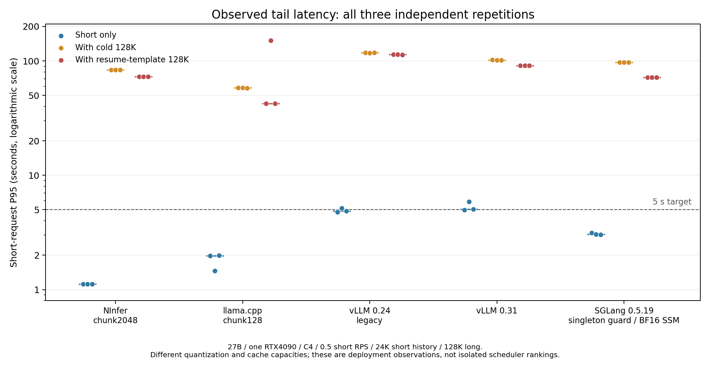

# 开源 PD 方案适配与验证

已测配置中的长短请求干扰仍然明显，但现有证据不足以将它称为研究空白。五种配置已各完成三轮完整27B/128K对照，共45组、1110/1110严格工具有效、30/30完整长请求完成、0错误；未靠拒绝或截断长请求降低短延迟。MorphX移植未通过正确性门槛，不能用它的兼容失败推断原方法无效。

vLLM 0.31/cu129和SGLang 0.5.19/cu129均已完成完整128K资格验证及三轮混合实验。SGLang明确采用下文标注的兼容补丁和BF16 SSM状态。此前仅cu128依赖解析失败不能证明新版本不可用；vLLM 0.24结果只作为旧版本实测，不能称为当前最强基线。

三轮重复的短请求P95范围如下，单位为秒。每组实际0.5 RPS、C4、MTP0；短请求约24K历史，长请求约128K，第16秒到达。

| 已测配置 | 纯短请求 | 冷长请求混合 | 续接模板混合 | 每配置严格工具有效 / 完整长请求 |
|---|---:|---:|---:|---:|
| NInfer，chunk2048 | 1.122–1.122 | 83.700–83.783 | 72.951–72.968 | 222/222；6/6 |
| llama.cpp，chunk128 | 1.460–1.995 | 57.848–58.452 | 42.376–151.347 | 222/222；6/6 |
| vLLM0.24，旧版eager/mem95 | 4.757–5.149 | 117.631–117.776 | 113.139–113.816 | 222/222；6/6 |
| vLLM0.31，eager/mem95 | 4.973–5.893 | 101.787–101.971 | 90.933–91.313 | 222/222；6/6 |
| SGLang0.5.19，chunk512/兼容补丁/BF16 SSM | 3.020–3.127 | 96.942–97.260 | 71.784–72.000 | 222/222；6/6 |

这些是各部署配置的端到端观测，不能直接算作调度优劣排名。量化、状态精度、实际缓存池和前缀重算量不同；vLLM的原生抢占也表明容量压力参与了混合延迟。llama.cpp把chunk2048改为128的单轮诊断将冷混合P95从132.968秒降至58.557秒，减少约74.4秒（56%），说明普通调优已有很大收益；调优后的三轮仍未达到5秒目标，续接组还保留了151秒的波动。MTP诊断改善短请求生成延迟，但没有消除长输入干扰。



图中每个点是一轮独立重启的实测P95，短横线为三轮中位数，不是置信区间。完整数据与输入哈希见 [严格汇总](../../results/pd-baselines/summary.json)、[组级CSV](../../results/pd-baselines/groups.csv)、[请求级CSV](../../results/pd-baselines/requests.csv)。

## 已得到的结果

同一 Qwen3.8-27B GGUF、单张 4090、C4、MTP关闭、共享 KV 池212992 token、q4_0，短请求含约24K历史。固定48秒短请求波次，第16秒加入128K长请求。所有表内混合组均实际完成长请求，没有截断或拒绝它来降低短请求延迟。

这是用于隔离长短请求干扰的合成负载；它不能直接估计真实企业或Agent流量中该问题的发生频率。

场景存在生产依据：[Copilot生产追踪论文](https://arxiv.org/html/2608.00101)统计到，包含上下文压缩事件的会话占7.8%，贡献44.2%的token消耗；压缩调用本身包含完整历史预填充，之后的前缀重写会降低缓存复用。这支持研究长会话中的重预填充，但不证明我们的128K/24K输入比例或83秒干扰在生产中有相同频率。

| llama.cpp 配置 | 短到达率 | 纯短请求 P95 | 加冷长请求后的短 P95 | 加续接长请求后的短 P95 |
|---|---:|---:|---:|---:|
| chunk2048，诊断各1轮 | 0.5 RPS | 1.972 s | 132.968 s | 未测 |
| chunk128，诊断各1轮 | 0.5 RPS | 1.974 s | 58.557 s | 42.320 s |
| chunk128，正式重复第1轮 | 0.5 RPS | 1.980 s | 58.451 s | 42.392 s |
| chunk128，正式重复第2轮 | 0.5 RPS | 1.460 s | 58.452 s | 151.347 s |
| chunk128，正式重复第3轮 | 0.5 RPS | 1.995 s | 57.848 s | 42.376 s |

这表明较小分块改善了当前配置的干扰，但尚未达到5秒短请求SLO。正式实验已完成9组，每组独立重启服务并通过完整代码检查，222/222请求工具语义有效，6次完整128K长请求均完成，未发生HTTP错误。单波次内的请求相互关联，独立重复数为3，不将请求总数当作独立样本量计算置信区间。完整摘要及原始文件哈希见 [正式三轮结果](../../results/pd-baselines/llama-main-v2-summary.json)。历史组名resume-high在这次实验中实际到达率为0.5 RPS，以记录的rate字段为准。

第二次正式续接重复的短P95进一步升到151.347秒，最大171.591秒；长请求反而在126.189秒完成。长请求仍命中24608 token，与首轮相同，因此不能用长请求缓存失效解释这个波动。原生日志中首轮长请求处于slot2，第二轮处于slot1；这是准入/分块调度需要进一步检查的相关证据，尚未做固定槽位的因果消融。所有重复均保留，不能只用42秒的一轮代表配置表现。当前明细见 [重复实验中间记录](../../results/pd-baselines/llama-repetition-progress.json)。

诊断轮中冷长请求实际输入131049 token、缓存0，耗时164.762秒；续接实际输入131038 token、命中24608、另算106430，耗时147.809秒。两组均25/25请求协议及工具语义有效。机器摘要见 [llama-ch128-diagnostic.json](../../results/pd-baselines/llama-ch128-diagnostic.json)。

另一个2.5 RPS的llama.cpp纯短控制组已自身过载，P95达102.098秒。因此不把该负载下的混合延迟全部归因于PD干扰。此前NInfer的2.5 RPS结果与这里0.5 RPS结果也不能直接计算调度改善倍数。

## 相同到达率的 NInfer 原始对照

NInfer原始NVCC构建、混合Q4/Q5权重、rk4v4-e8缓存、C4、MTP0、chunk2048、212992 token池，已完成9组独立重启的实验。222/222请求严格工具校验通过，6次完整128K长请求完成、0错误。输入和到达规则与上表相同，实际0.5 RPS。

| 独立重复 | 纯短请求 P95 | 冷长请求混合的短 P95 | 续接模板混合的短 P95 |
|---|---:|---:|---:|
| 第1轮 | 1.122 s | 83.700 s | 72.952 s |
| 第2轮 | 1.122 s | 83.783 s | 72.951 s |
| 第3轮 | 1.122 s | 83.774 s | 72.968 s |

原生计数确认控制组每个短请求输入24558 token，命中24554、重算4。相较之下，下文vLLM0.24每次重算1037 token，不能用跨引擎端到端比值直接归因于调度。完整组级统计、显存采样和原始文件哈希见 [NInfer三轮结果](../../results/pd-baselines/ninfer-main-v2-summary.json)。

## MTP 对当前干扰的作用

NInfer MTP4通过了单独的完整128K工具请求，并完成一轮相同0.5 RPS/C4的三组诊断，74/74工具有效、两次混合长请求完成。纯短请求P95降至0.417秒，混入冷长请求后仍为82.039秒，续接组为81.322秒。该轮显示生成加速没有消除当前长预填充等待；它只有一次重复，而且续接组有两个短请求未复用前缀，不能把它与MTP0三轮的差异全部归因于投机解码。

vLLM0.24的MTP1配置在保持131328窗口时实际启动失败：需要4.73 GiB KV，只有3.96 GiB。没有降低上下文长度或将其计作性能结果。MTP附加模型的内存成本需要和生成加速一起考虑。见 [MTP诊断与失败记录](../../results/pd-baselines/mtp-diagnostic-summary.json)。

## MorphX 的实际状态

已固定作者源码4404aed4c180ad83c31179e1ce08ae2234390853，完成LLVM18/SM89编译器适配、CUDA Runtime真正拦截和独立数值探针。原GDRCopy路径实际调用gdr_open失败，设备/dev/gdrdrv不存在；当前实验使用显式标注的映射主存控制通道。这改变了控制数据所在位置及访问开销，不能冒充论文原始GDRCopy环境。

| 完整 CTest 调用 | 实际执行 | 通过 | 失败 | 缺外部模型而跳过 |
|---|---:|---:|---:|---:|
| 相同Clang构建，关闭hook | 79 | 79 | 0 | 5 |
| 允许默认流的初始移植 | 79 | 50 | 29 | 5 |
| 修正统计表访问、退出生命周期及队列发布 | 79 | 74 | 5 | 5 |

调试器捕获到后台agent访问gCI统计表时崩溃，主线程正在退出并等待agent。修正后原先多项崩溃消失。另一个显式兼容变体在Graph capture期间保留原生kernel节点，避免重放已经释放的单次控制缓冲区；针对原先5项失败的复测中，3项Graph测试通过，仍剩GDN投影launch failure和GQA数值错误。该变体尚未重新完整调用79项，不能将定向测试合并成一次完整通过。

完整27B模型也已经实际尝试：hook路径在预热中命中了改写后的bf16_gdn_gating_proj_gemm_mma_kernel，并发生cudaErrorLaunchFailure。关闭hook的Clang对照能启动，但一次完整代码验证生成了缩进错误，未通过质量门槛。这些失败均保留；没有用失败配置生成“有效MorphX吞吐”。见 [兼容性证据](../../results/pd-baselines/compatibility/progress.json)。

另在固定源码中发现明确的launch语义差异：失败的GDN SplitK算子通过cudaLaunchKernelEx设置Cooperative属性，并调用this_grid().sync()；MorphX runtime的cuLaunchKernelEx直接转换为cuLaunchKernel，没有传递attrs/numAttrs。该静态差异尚未用保留属性的GPU A/B验证为本次故障的原因，因此只记录为待解决的兼容问题，不宣称已修复。

因此当前结论是移植尚未合格，不能回答MorphX在本机能改善多少，也不能据此宣称MorphX原方法无效。尤其仅改写kernel并不会自动改变NInfer的单prefill准入策略；要评价PD机制，还需要配套请求准入及实际P/D重叠，并保留相同准入策略关闭MorphX的消融。

另已实际运行共享内存生命周期整数探针，原生、原MorphX改写、增加虚拟CTA结束屏障三条路径均通过32768项独立整数校验，后两者均观察到改写kernel启动。因此这个探针未复现候选问题，不能证明结束屏障是GDN/GQA故障的修复。屏障变体尚未做完整模型算子验证，不替代原始失败记录。见 [探针原始诊断](../../results/pd-baselines/compatibility/morphx-shared-lifetime.json)。

## vLLM 0.24：旧版本对照与容量调优

同源27B INT4模型已从hf-mirror下载，revision为91bd022d5b49442a868bc35008f6c21e1860edfa，9个文件完成校验。vLLM固定0.24.0：默认wheel实际导入时缺libcudart.so.13；换用官方CUDA12.9 wheel后，Torch2.11.0+cu128与vLLM核心stable扩展导入通过，实际CLI解析也通过。wheel哈希及包版本见 [安装阶段环境清单](../../results/pd-baselines/vllm-environment.json)。

初始候选为C4、完整131328 token窗口、FP8 KV、Mamba align缓存、batch预算4096、单请求待计算token上限2048、关闭Graph的容量探针。后续根据实际分配、质量和延迟再调优Graph及分块；212992只是比较容量目标，vLLM实际分配的池大小必须另行观察，不能把目标值写成实测容量。

单请求上限会给同一轮其他请求留出token预算；其作用需要实测。[官方参数说明](https://docs.vllm.ai/en/v0.24.0/configuration/engine_args/)和[该版本V1调度源码](https://github.com/vllm-project/vllm/blob/v0.24.0/vllm/v1/core/sched/scheduler.py)是配置依据。本次安装源码中的V1路径直接使用long_prefill_token_threshold，不应仅凭max_num_partial_prefills配置项存在就认定它已经改变实际调度。

实际GPU探针V2中模型占16.84 GiB，显存比例0.98时分配5.49 GiB缓存、166348 token实际池，随后通过完整代码检查；4个24K工具预热请求触发引擎OOM，首个失败位置为FLA的recompute_w_u_fwd申请20 MiB张量。故尚未进入128K请求验证，也没有有效PD性能数据，不能用启动时显示的最大并发量作为实际容量通过。见 [失败摘要与完整引擎回溯](../../results/pd-baselines/vllm-mem98-warmup-failure.json)。下一探针只将显存比例降至0.95，保留相同模型、上下文、分块及质量门槛，检查预填充工作空间与实际KV池的取舍。

V3将显存比例降至0.95后，实际池4.78 GiB、144460 token；代码检查、4个并发24K工具预热及完整128K请求均通过。长请求实际输入131049 token、输出64 token，工具参数正确且未截断，TTFT78.943秒、总耗时82.432秒。当前API没有返回逐请求cached_tokens，不将其标为缓存计数已验证；该探针只证明此配置能完成单个128K请求，不证明混合负载SLO。见 [128K探针记录](../../results/pd-baselines/vllm-mem95-128k-probe.json)。原服务已恢复后才开始同到达率混合组，另排队验证默认编译/CUDA Graph配置，避免把eager路径作为最优性能结论。

随后eager/mem95完成一轮3组诊断，均实际0.5 RPS，各组重启服务；74/74请求工具有效、2次128K长请求完成。纯短请求P95为4.757秒；混入冷长请求后117.724秒，续接模板组113.712秒，两混合组各记录到2次抢占。长请求分别耗时102.653、90.013秒。缓存池小于llama.cpp的212992 token，不能将这组结果归因为单独的调度优劣。没有逐请求缓存计数，续接组仅按输入模板命名，尚不称为已验证的长请求缓存命中。见 [完整诊断摘要](../../results/pd-baselines/vllm-mem95-eager-diagnostic.json)。

同一模型、调度和容量配置现已补齐3轮独立重复，共9组、222/222工具有效、6次完整长请求完成、0错误。三轮的短请求P95如下；第二、三轮只额外启用了API原生缓存计数输出，保留每轮结果，不回填第一轮缺失的计数。机器摘要与全部源文件哈希见 [vLLM三轮结果](../../results/pd-baselines/vllm-main-v3-summary.json)。

| 独立重复 | 纯短请求 P95 | 冷长请求混合的短 P95 | 续接模板混合的短 P95 |
|---|---:|---:|---:|
| 第1轮 | 4.757 s | 117.724 s | 113.712 s |
| 第2轮 | 5.149 s | 117.631 s | 113.816 s |
| 第3轮 | 4.871 s | 117.776 s | 113.139 s |

本配置混合组的200 ms显存采样最大值为24101 MiB，对应空闲仅7 MiB。采样覆盖服务健康后的代码检查、预热及负载，排除启动；它会漏掉短暂峰值，不能当作精确分配器峰值。结果表明该配置在已测形状下通过，不代表拥有充足显存余量。

这轮API时间线区分了首输出前的等待和首输出后的生成区间。蓝色包含排队、输入处理及其他等待，橙色也可能包含调度等待，均不是GPU算子耗时。图中所有组实际0.5 RPS；只展示一次诊断重复。


后续重复启用原生prompt_tokens_details后，已观察到控制组24个短请求均命中23520、各重算1037 token；混合冷组23个命中23520、1个命中0。相同输入的llama.cpp控制组则各命中24553、各计算4 token。后续续接长请求也实际报告23520缓存命中、总输入131038。不同缓存复用粒度改变了每次调用的计算量，必须与调度影响分开；不能用端到端延迟比值直接声称某个调度器更差。 API的prompt减cached表示请求计费边界上的未命中输入，不覆盖抢占后的内部重放，不能当作全部实际GPU预填充token数。最终导出会另列已观察到的原生抢占计数；缺计数不会填0。此前没有计数的诊断轮不补写这些观测。

默认编译/Graph配置实际启动失败：KV可用2.39 GiB，而完整131328窗口至少需要4.31 GiB；标准1 GiB CPU权重卸载使模型显存由16.84降到15.76 GiB，KV增至3.46 GiB，仍不足以启动该窗口。两次失败及恢复均保留，未缩短输入换取通过，见 [Graph容量失败记录](../../results/pd-baselines/vllm-graph-capacity-failures.json)。继续验证受支持的mode0/FULL_DECODE_ONLY组合及容量设置，不能据此笼统断言Graph不能用。

后续mode0/FULL_DECODE_ONLY实测：mem95全驻留仅4.20 GiB KV，仍无法启动完整窗口；增加1 GiB权重卸载后，池为160512 token，代码、4并发工具预热和完整128K均通过，但长请求耗时187.866秒、TTFT183.150秒。全驻留mem98、eager mem967，以及总batch减至2048的decode Graph/mem98，均通过代码检查后在并发24K预热OOM；不能将其启动时显示的148838–159052 token池算作可用容量。见 [5个候选的完整结果与失败证据](../../results/pd-baselines/vllm-resident-graph-outcomes.json)。本轮收束参数探索，复测已验证的eager/mem95；卸载路径证明Graph可运行，但它的容量与速度代价需另列。

还有一个明确的分块约束：实际启动日志将attention块设为1568 token以匹配Mamba状态页；本版align调度要求long_prefill_token_threshold不小于该块，不能直接照搬llama.cpp的128分块。[10月14日合入的上游内部checkpoint改动](https://github.com/vllm-project/vllm/pull/60050)面向FlashInfer GDN预填充，明确没有改动Triton/FLA路径；本机当前使用Triton，因此不能直接将该改动的GB200收益当成本机结果。

V1探针在测量前发现FlashInfer将约17 MB新生成编译缓存写入默认home缓存，已受控停止并恢复服务；随后只迁移本次生成的0.6.12目录至HDD，保留旧版本目录，显式配置FLASHINFER_WORKSPACE_BASE和TORCH_EXTENSIONS_DIR，并验证解析后的路径位于HDD。该中断不算模型性能或容量失败。

## 新版 CUDA 12.9 路线的实际验证

vLLM0.31.0+cu129与Torch2.13.0+cu129已在隔离环境完成安装、核心CUDA扩展导入和实际GPU模型推理，无需修改服务器驱动。默认TorchCodec0.17媒体包依赖libnvrtc.so.13，曾导致服务入口导入失败；改用官方CPU媒体包后，相同服务入口检查通过，模型文本推理仍在GPU。完整依赖版本、原失败与修复检查的哈希见 [新版vLLM环境](../../results/pd-baselines/vllm031-environment-before-probe.json)。

同一RedHat27B权重、FP8 KV、C4、MTP0、eager/mem95，在三次独立重启后均通过代码检查、4路24K工具预热及完整128K工具请求。三轮长请求耗时83.052、83.066、82.906秒，均未截断且工具参数正确。首轮实际池143001 token、4.73 GiB，模型16.84 GiB，GDN使用Triton/FLA，Attention使用FlashInfer，Mamba对齐块仍为1568 token。[新版128K三轮记录及原始数据哈希](../../results/pd-baselines/vllm031-128k-probes.json)证明当前硬件可部署与完整上下文资格；混合负载结果另列如下，不将容量探针当作PD改善结果。

同一新版固定配置现已完成三轮同到达率混合实验：9组、222/222工具有效、6次完整长请求完成、0错误。三轮结果均保留，见 [vLLM0.31三轮统计与原始数据哈希](../../results/pd-baselines/vllm031-main-v1-summary.json)。

| 独立重复 | 纯短请求 P95 | 冷长请求混合的短 P95 | 续接模板混合的短 P95 |
|---|---:|---:|---:|
| 第1轮 | 4.973 s | 101.971 s | 91.047 s |
| 第2轮 | 5.893 s | 101.787 s | 91.313 s |
| 第3轮 | 5.041 s | 101.811 s | 90.933 s |

本轮冷长组各发生3次原生抢占，续接组各2次；所有组200 ms采样的最小空闲显存约83 MiB，范围仍只覆盖服务健康后的质量检查、预热和测量。控制组自身也有超过5秒目标的重复，不能把全部SLO不达标都归因于长请求。混合组则稳定退化到约91–102秒。新版改善了旧版已测配置的混合延迟，尚未解决该配置下的尾延迟；这不是所有vLLM调优方案的性能上限。

SGLang0.5.19的官方CUDA12依赖路线已实际安装并运行完整27B模型。其kernel/DeepEP/DeepGEMM均采用作者发布的cu129 wheel，下载加速传输后逐文件核对官方SHA256。依赖调整依据官方Dockerfile，不修改系统CUDA或驱动。见 [初始环境](../../results/pd-baselines/sglang0519-environment-before-probe.json)。

当前资格验证暴露了三类实际问题，均保留失败记录：

- 该版本的language-model-only命令行白名单不包含Qwen；改用其已有的HF配置覆盖位后，完整64层语言模型能启动，未修改共享权重或配置文件。
- FP32 SSM、lazy20状态池下，实际KV容量仅69976 token，不能用131328的命令行窗口宣称支持128K。已有unified GPU池在FlashInfer与Triton路径分别出现FP8视图/编译兼容错误。BF16状态和较小状态池能扩大容量，但mem98/mem975在实际质量检查中OOM，尚未获得性能资格。BF16状态的窄功能门槛也不能证明整体质量无损。
- mem97/96/95均通过代码生成检查，却在强制工具调用时触发单rank NCCL communicator的512 MiB临时分配。调用栈与[上游已知问题35826](https://github.com/sgl-project/sglang/issues/35826)吻合。现在只在所选通信组world_size≤1时跳过恒等归约，保留多rank的MIN操作；修复前CPU回归复现错误，修复后单rank检查和真实双rank Gloo数值检查均通过，项目146项测试通过。

这个补丁是明确标注的兼容修复，没有增加PD调度机制。补丁及源码前后SHA、失败和通过日志见 [修复记录](../../results/pd-baselines/compatibility/sglang-singleton-guard/provenance.json)，依赖及实际源码清单见 [修复后环境](../../results/pd-baselines/sglang0519-environment-singleton-guard.json)。修复后mem97、BF16 SSM/lazy12/skiplock、FP8 KV、chunk512、eager通过代码检查、四路24K工具预热及完整128K工具请求；独立容量探针耗时85.473秒，实际池152639 token（4.658 GiB），实际C4。见 [终态资格记录](../../results/pd-baselines/sglang-singleton-128k-qualified.json)。

同一配置随后完成9组独立重启的正式测量，222/222严格工具有效、6次完整长请求完成、0错误：

| 独立重复 | 纯短请求P95 | 冷长请求混合的短P95 | 续接模板混合的短P95 |
|---|---:|---:|---:|
| 第1轮 | 3.127 s | 97.260 s | 71.787 s |
| 第2轮 | 3.045 s | 96.942 s | 72.000 s |
| 第3轮 | 3.020 s | 97.071 s | 71.784 s |

冷长请求耗时88.32–88.56秒，续接模板长请求76.54–76.73秒。API未启用逐请求缓存用量报告，因此保留unobserved标签，不能仅凭更快的时间把续接组称为已验证命中。原生prefill日志有缓存命中证据，但不回填缺失API计数；重置型num_retracted_reqs Gauge也不当作累计抢占次数。全部组200 ms采样的显存峰值24106 MiB、最小空闲2 MiB，范围仅覆盖健康后的质量、预热和测量；这没有可观的部署余量。见 [三轮完整统计](../../results/pd-baselines/sglang-main-v5-summary.json)和[所有SGLang尝试及失败](../../results/pd-baselines/sglang-attempts.json)。

还检查了该版本已有的PD-Multiplexing开关。它采用green-context流并调用模型的forward_split_prefill接口；在CPU上实际调用当前Qwen模型对应的ModelRunner入口，得到缺少该模型方法的AttributeError，继承链上也没有该接口。见 [实际接口探针及源码SHA](../../results/pd-baselines/compatibility/sglang-pdmux-cpu-interface.json)。因此它需要额外模型适配，不能把打开开关当作现成可用的当前模型基线；这里未测其GPU执行、green-context支持或PD效果。

源码检查也提示，分块不等于新请求能立即准入：该版本scheduler先调用add_chunked_req，后遍历等待队列；add_chunked_req会消耗当前可用chunk预算。另一方面，完整候选输入和输出还受总token预算约束。实际152639池小于两个完全不共享前缀的131K与24K历史之和。这些是需要区分的准入与容量因素；当前没有记录每次准入拒绝分支，也没有固定容量的因果消融，不能据此判定唯一根因或宣称带宽已达roofline。

## 现有方法已经覆盖什么

| 方法 | 已有机制或证据 | 对本课题的含义 |
|---|---|---|
| [vLLM AgentX调度](https://github.com/vllm-project/vllm-project.github.io/blob/main/_posts/2026-09-08-vllm-agentx.md) | 用单请求token上限缓解Agent流量的队头阻塞；另有DP预填充节奏控制 | “给长预填充分块、给短请求留预算”已经有现成实现；本版prefill_schedule_interval仅DP EngineCore使用，不能给单GPU传一个参数就认定生效 |
| [PackServe](https://arxiv.org/abs/2609.33224) | 以白盒模型预测P/D干扰，在保留前缀复用及token延迟SLO下将Agent请求整合到更少实例；论文包含64张H20评估及生产部署 | 干扰预测、缓存局部性与SLO联合调度已有近期企业工作；集群资源节省不是本机单卡效果，本机尚未部署 |
| [DuetServe](https://arxiv.org/abs/2511.04791) | 根据迭代延迟预测，在同一GPU内自适应切分SM来隔离P/D，包含Attention感知roofline与提前decode派发 | 单GPU自适应资源隔离及roofline驱动分配已经有前人工作；本机未部署，不能用当前失败或延迟推翻论文效果 |
| [Hypic](https://arxiv.org/abs/2607.01299) | 面向Hybrid模型缓存分段状态转移，以边界窗口修复完整Attention，并并行处理未命中的段 | “Agent上下文由片段组成，线性状态不能直接按KV方式复用”已有机制；本机未部署，近似质量及多实例收益不能代替本机单卡严格工具测量 |
| [Marconi](https://arxiv.org/abs/2411.19379) | 面向Hybrid模型，按复用潜力和计算收益/状态空间开销选择checkpoint的准入与淘汰 | Hybrid状态与Attention KV不同、应考虑重算收益，这些本身已不是新意 |
| [vLLM内部checkpoint](https://github.com/vllm-project/vllm/pull/60050) | FlashInfer GDN在一次预填充中导出边界状态，减少为缓存边界拆分forward的额外工作 | 必须核对GPU与backend适用性；当前Triton路径没有得到这个改动的实测收益 |
| [SuffixReplay](https://arxiv.org/html/2609.33477) | 通过有限后缀重放近似重建线性状态，减少对密集checkpoint的依赖；论文在三种Hybrid模型上报告LongBench/RULER平均质量保留91.4–100% | 更细复用边界也已有新方法；其近似质量与代码Agent工具正确性不能等同，需要单独评估，本机尚未部署 |

因此有依据的下一步是：先看容量可用、质量合格的现成调度在本机能达到的延迟与长请求完成代价，再决定是否值得研究更细的调度机制。上表未在本机测试的方案不归为失败，也不以论文数值替代这里的128K混合负载结果。

### 后续方案的源码核查（2026-10-15）

本轮仅做源码可行性核查，未新增GPU性能实验。下载位于服务器HDD的`pd-baselines/feasibility-20261015`；固定提交、逐文件SHA256和原始检索结果见[源码审计](../../results/pd-baselines/compatibility/sota-source-audit-20261015.json)。

- **PD-Multiplexing：** 已安装SGLang0.5.19的实际CPU入口调用证明本模型缺少`forward_split_prefill`，见[接口探针](../../results/pd-baselines/compatibility/sglang-pdmux-cpu-interface.json)。本次也固定了上游源码86f4ede4fbc3543ea431bb7caccd7069dde7430b；不能把有`--enable-pdmux`参数当作本模型已经可用，模型适配、Green Context硬件路径和实际P/D重叠仍需验证。作者的[公开实现与实验说明](https://github.com/sgl-project/sglang/issues/10813)主要针对ITL；本负载还必须测新短请求的准入等待。
- **DuetServe：** [ICML2026正式论文](https://proceedings.mlr.press/v306/gao26m.html)采用按需SM切分与提前decode派发，属于直接相关的单GPU机制基线。本轮核对了论文和作者主页，尚未找到可确认的作者公开实现入口；不将其列为已经下载或可直接部署的代码。
- **HYPIC：** 已实际取得作者仓库98147c01909004e66d98bcb18b886927d41b0ee5的README和Qwen模型源码，后者含Dense和MoE类及PIC路径。审计中的单独`qwen3_5_moe.py`返回404，是路径探查结果，不能解释为不支持MoE；相关类位于同一`qwen3_5.py`中。它适合可复用片段场景，当前27B INT4完整128K资格尚未验证。对于完全不可复用的冷输入，单卡缓存复用不能消除原始预填充工作量；多worker分段并行不属于单4090预算。
- **POD-Attention：** [作者公开的ASPLOS2025论文及artifact说明](https://akkamath.github.io/files/ASPLOS25_POD.pdf)提供融合P/D Attention算子的实现，可作为算子层机制参考；原实验为A100及传统Attention模型。当前Hybrid模型仅部分层使用Full Attention，不能假定它覆盖GDN或解决请求准入，尚未适配或实测。

“简单方法已经无效”尚无证据。较小chunk已明显改善llama.cpp；下一项应在同引擎、同量化、同实际容量下对照短请求优先准入、每请求预算与长请求进度约束。SGLang中正在续算的长prefill先消耗当轮chunk预算、随后才扫描等待队列，是需要插桩及因果消融的线索；单凭静态顺序不能证明全部延迟由它造成。vLLM已存在单请求预算机制，因此即便普通准入修正有效，也首先应作为现有策略基线，而非创新点。只有这些基线仍无法在短请求SLO、长请求完成时间及总吞吐之间取得可接受平衡，才有依据继续提出更复杂的机制。

## 可复现性与恢复检查

完整原始数据、源码、编译日志和模型均在服务器HDD的InferX/pd-baselines目录。当前正式llama实验的启动时4个关键Python文件已按其启动时SHA256精确重建并留档，明确标为事后重建；见 [重建清单](../../results/pd-baselines/harness-llama-main-v2/provenance.json)。后续controller会在启动时保存完整脚本及inferx模块字节，避免工作目录更新覆盖实验实现。

全部GPU实验均已终止并恢复原服务。严格导出包含41个campaign、63个完整组、30个未完成组、1499条已观察响应和590个输入文件哈希；未完成、兼容失败及操作中断均保留，不进入合格配置的重复比较。两次独立严格导出的四个文件SHA256完全一致，本地副本也逐文件核对。见 [审计计数](../../results/pd-baselines/audit.json)与[导出校验](../../results/pd-baselines/final-export-verification.json)。

原GPU1服务恢复为256K/MTP7/C1/rk4v4-e8，PID3433597；实际UID/exe/startticks/完整argv和两份manifest一致，OpenAI严格强制工具调用及Anthropic工具结果往返均通过，GPU0原PID2504785健康。见 [最终服务核验](../../results/pd-baselines/final-service-verification.json)。最终探针首次附带NInfer不支持的chat_template_kwargs字段而收到400；移除该客户端字段、沿用服务本身的no-thinking设置后通过，未修改服务配置，原拒绝记录也已保留。SGLang新版本忽略XDG设置而产生的约11 MiB独立JIT缓存，已在服务终止后按逐文件哈希迁至HDD，并为旧路径建立指向HDD的符号链接；见 [迁移记录](../../results/pd-baselines/sglang-cache-migration.json)。模型及依赖下载均在HDD。

独立复审已完成，并独立核对590个原始文件哈希、45个不同服务实例及全部主实验响应。随后在一轮修复中补齐SIGTERM/SIGHUP恢复、创建/清理临界区的信号延后、前端退出后仍存活的工作进程清理，以及48秒窗口统计导出。15个新增回归均经历实际失败再通过，完整测试161项通过；原始测量不重写。重新导出的旧字段与原始哈希完全一致，新增固定窗口完成数分别区分协议成功和严格工具有效，时间缺失保持未知。见 [独立复审及处理](../../results/pd-baselines/execution/final-review.md)与[修复后服务核验](../../results/pd-baselines/final-service-after-fixes.json)。

不同量化、池容量和残余预填充尚未被固定成同一条件，因此当前结论是已测工程配置没有解决该负载下的短尾延迟，不是现有最强方法的上限，更不是已证明的新研究空白。

服务器上的复现入口如下；run-id须使用新名称。该命令临时占用实验GPU1，controller结束后恢复原服务。实验GPU0上的服务保持运行。

```bash
source /home/guokc/mypro/gnn-mount-sda1/InferX/env.sh
cd "$INFERX_ROOT/code-pd-baselines"
"$INFERX_ROOT/repo-venv/bin/python" -m scripts.run_pd_baselines \
  --config configs/pd-baselines.json \
  --cases vllm031-int4-c4-b4096-cap2048-eager-mem95 \
  --run-id reproduce-vllm031-UNIQUE --repeat 3 \
  --groups short-control cold-low resume-high --short-rate .5
```

所有controller终止并完成恢复后，使用严格导出；它会拒绝把仍在运行的campaign作为最终数据。

```bash
"$INFERX_ROOT/repo-venv/bin/python" -m scripts.analyze_pd_baselines \
  "$INFERX_ROOT/pd-baselines/raw" "$INFERX_ROOT/pd-baselines/derived-final"
```

功能门槛为冻结代码题及严格工具参数检查，不能替代比赛公开任务集或LongBench等完整质量评估。不同量化的总体质量无损不在本次数据结论中。

TTFT也必须区分API可见输出与模型首token。NInfer本轮一个热短工具调用的客户端首输出约1.119秒、总耗时约1.120秒，而原生日志模型TTFT为62毫秒，工具调用在生成后才整体输出。客户端first-to-final区间对应输出传送速率，不能将其中计算的observed_decode_tps当作模型解码速度；本报告主要吞吐用实际完成token数除以包含排空的完整区间。见 [工具流语义证据](../../results/pd-baselines/tool-stream-semantics-evidence.json)。
