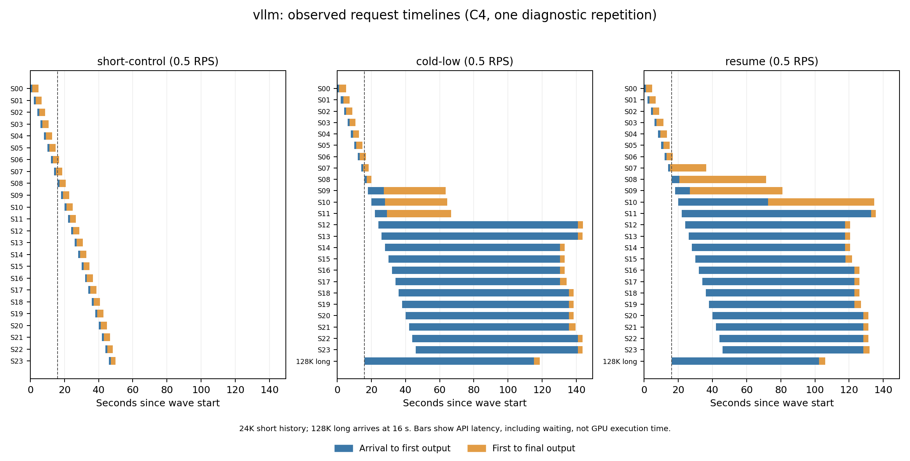

# 开源 PD 方案适配与验证（进行中）

目前不能把已发现的长短请求干扰称为现有系统尚未解决的研究空白。llama.cpp 分块调优后三轮独立重复仍有明显尾延迟；MorphX 移植尚未通过正确性门槛；vLLM 已完成一轮完整27B/128K混合诊断，当前容量下仍有明显延迟及抢占，正在检查Graph与容量配置。以下数据不构成最终跨引擎排名。

## 已得到的结果

同一 Qwen3.8-27B GGUF、单张 4090、C4、MTP关闭、共享 KV 池212992 token、q4_0，短请求含约24K历史。固定48秒短请求波次，第16秒加入128K长请求。所有表内混合组均实际完成长请求，没有截断或拒绝它来降低短请求延迟。

这是用于隔离长短请求干扰的合成负载；它不能直接估计真实企业或Agent流量中该问题的发生频率。

| llama.cpp 配置 | 短到达率 | 纯短请求 P95 | 加冷长请求后的短 P95 | 加续接长请求后的短 P95 |
|---|---:|---:|---:|---:|
| chunk2048，诊断各1轮 | 0.5 RPS | 1.972 s | 132.968 s | 未测 |
| chunk128，诊断各1轮 | 0.5 RPS | 1.974 s | 58.557 s | 42.320 s |
| chunk128，正式重复第1轮 | 0.5 RPS | 1.980 s | 58.451 s | 42.392 s |
| chunk128，正式重复第2轮 | 0.5 RPS | 1.460 s | 58.452 s | 151.347 s |
| chunk128，正式重复第3轮 | 0.5 RPS | 1.995 s | 57.848 s | 42.376 s |

这表明较小分块改善了当前配置的干扰，但尚未达到5秒短请求SLO。正式实验已完成9组，每组独立重启服务并通过完整代码检查，222/222请求工具语义有效，6次完整128K长请求均完成，未发生HTTP错误。单波次内的请求相互关联，独立重复数为3，不将请求总数当作独立样本量计算置信区间。完整摘要及原始文件哈希见 [正式三轮结果](../../results/pd-baselines/llama-main-v2-summary.json)。历史组名resume-high在这次实验中实际到达率为0.5 RPS，以记录的rate字段为准。

第二次正式续接重复的短P95进一步升到151.347秒，最大171.591秒；长请求反而在126.189秒完成。长请求仍命中24608 token，与首轮相同，因此不能用长请求缓存失效解释这个波动。原生日志中首轮长请求处于slot2，第二轮处于slot1；这是准入/分块调度需要进一步检查的相关证据，尚未做固定槽位的因果消融。所有重复均保留，不能只用42秒的一轮代表配置表现。当前明细见 [重复实验中间记录](../../results/pd-baselines/llama-repetition-progress.json)。

诊断轮中冷长请求实际输入131049 token、缓存0，耗时164.762秒；续接实际输入131038 token、命中24608、另算106430，耗时147.809秒。两组均25/25请求协议及工具语义有效。机器摘要见 [llama-ch128-diagnostic.json](../../results/pd-baselines/llama-ch128-diagnostic.json)。

另一个2.5 RPS的llama.cpp纯短控制组已自身过载，P95达102.098秒。因此不把该负载下的混合延迟全部归因于PD干扰。此前NInfer的2.5 RPS结果与这里0.5 RPS结果也不能直接计算调度改善倍数。

## MorphX 的实际状态

已固定作者源码4404aed4c180ad83c31179e1ce08ae2234390853，完成LLVM18/SM89编译器适配、CUDA Runtime真正拦截和独立数值探针。原GDRCopy路径实际调用gdr_open失败，设备/dev/gdrdrv不存在；当前实验使用显式标注的映射主存控制通道。这改变了控制数据所在位置及访问开销，不能冒充论文原始GDRCopy环境。

| 完整 CTest 调用 | 实际执行 | 通过 | 失败 | 缺外部模型而跳过 |
|---|---:|---:|---:|---:|
| 相同Clang构建，关闭hook | 79 | 79 | 0 | 5 |
| 允许默认流的初始移植 | 79 | 50 | 29 | 5 |
| 修正统计表访问、退出生命周期及队列发布 | 79 | 74 | 5 | 5 |

调试器捕获到后台agent访问gCI统计表时崩溃，主线程正在退出并等待agent。修正后原先多项崩溃消失。另一个显式兼容变体在Graph capture期间保留原生kernel节点，避免重放已经释放的单次控制缓冲区；针对原先5项失败的复测中，3项Graph测试通过，仍剩GDN投影launch failure和GQA数值错误。该变体尚未重新完整调用79项，不能将定向测试合并成一次完整通过。

完整27B模型也已经实际尝试：hook路径在预热中命中了改写后的bf16_gdn_gating_proj_gemm_mma_kernel，并发生cudaErrorLaunchFailure。关闭hook的Clang对照能启动，但一次完整代码验证生成了缩进错误，未通过质量门槛。这些失败均保留；没有用失败配置生成“有效MorphX吞吐”。见 [兼容性证据](../../results/pd-baselines/compatibility/progress.json)。

另在固定源码中发现明确的launch语义差异：失败的GDN SplitK算子通过cudaLaunchKernelEx设置Cooperative属性，并调用this_grid().sync()；MorphX runtime的cuLaunchKernelEx直接转换为cuLaunchKernel，没有传递attrs/numAttrs。该静态差异尚未用保留属性的GPU A/B验证为本次故障的原因，因此只记录为待解决的兼容问题，不宣称已修复。

因此当前结论是移植尚未合格，不能回答MorphX在本机能改善多少，也不能据此宣称MorphX原方法无效。尤其仅改写kernel并不会自动改变NInfer的单prefill准入策略；要评价PD机制，还需要配套请求准入及实际P/D重叠，并保留相同准入策略关闭MorphX的消融。

另已实际运行共享内存生命周期整数探针，原生、原MorphX改写、增加虚拟CTA结束屏障三条路径均通过32768项独立整数校验，后两者均观察到改写kernel启动。因此这个探针未复现候选问题，不能证明结束屏障是GDN/GQA故障的修复。屏障变体尚未做完整模型算子验证，不替代原始失败记录。见 [探针原始诊断](../../results/pd-baselines/compatibility/morphx-shared-lifetime.json)。

## vLLM 的实际状态与下一项验证

同源27B INT4模型已从hf-mirror下载，revision为91bd022d5b49442a868bc35008f6c21e1860edfa，9个文件完成校验。vLLM固定0.24.0：默认wheel实际导入时缺libcudart.so.13；换用官方CUDA12.9 wheel后，Torch2.11.0+cu128与vLLM核心stable扩展导入通过，实际CLI解析也通过。wheel哈希及包版本见 [安装阶段环境清单](../../results/pd-baselines/vllm-environment.json)。

初始候选为C4、完整131328 token窗口、FP8 KV、Mamba align缓存、batch预算4096、单请求待计算token上限2048、关闭Graph的容量探针。后续根据实际分配、质量和延迟再调优Graph及分块；212992只是比较容量目标，vLLM实际分配的池大小必须另行观察，不能把目标值写成实测容量。

单请求上限会给同一轮其他请求留出token预算；其作用需要实测。[官方参数说明](https://docs.vllm.ai/en/v0.24.0/configuration/engine_args/)和[该版本V1调度源码](https://github.com/vllm-project/vllm/blob/v0.24.0/vllm/v1/core/sched/scheduler.py)是配置依据。本次安装源码中的V1路径直接使用long_prefill_token_threshold，不应仅凭max_num_partial_prefills配置项存在就认定它已经改变实际调度。

实际GPU探针V2中模型占16.84 GiB，显存比例0.98时分配5.49 GiB缓存、166348 token实际池，随后通过完整代码检查；4个24K工具预热请求触发引擎OOM，首个失败位置为FLA的recompute_w_u_fwd申请20 MiB张量。故尚未进入128K请求验证，也没有有效PD性能数据，不能用启动时显示的最大并发量作为实际容量通过。见 [失败摘要与完整引擎回溯](../../results/pd-baselines/vllm-mem98-warmup-failure.json)。下一探针只将显存比例降至0.95，保留相同模型、上下文、分块及质量门槛，检查预填充工作空间与实际KV池的取舍。

V3将显存比例降至0.95后，实际池4.78 GiB、144460 token；代码检查、4个并发24K工具预热及完整128K请求均通过。长请求实际输入131049 token、输出64 token，工具参数正确且未截断，TTFT78.943秒、总耗时82.432秒。当前API没有返回逐请求cached_tokens，不将其标为缓存计数已验证；该探针只证明此配置能完成单个128K请求，不证明混合负载SLO。见 [128K探针记录](../../results/pd-baselines/vllm-mem95-128k-probe.json)。原服务已恢复后才开始同到达率混合组，另排队验证默认编译/CUDA Graph配置，避免把eager路径作为最优性能结论。

随后eager/mem95完成一轮3组诊断，均实际0.5 RPS，各组重启服务；74/74请求工具有效、2次128K长请求完成。纯短请求P95为4.757秒；混入冷长请求后117.724秒，续接模板组113.712秒，两混合组各记录到2次抢占。长请求分别耗时102.653、90.013秒。缓存池小于llama.cpp的212992 token，不能将这组结果归因为单独的调度优劣。没有逐请求缓存计数，续接组仅按输入模板命名，尚不称为已验证的长请求缓存命中。见 [完整诊断摘要](../../results/pd-baselines/vllm-mem95-eager-diagnostic.json)。

同一模型、调度和容量配置现已补齐3轮独立重复，共9组、222/222工具有效、6次完整长请求完成、0错误。三轮的短请求P95如下；第二、三轮只额外启用了API原生缓存计数输出，保留每轮结果，不回填第一轮缺失的计数。机器摘要与全部源文件哈希见 [vLLM三轮结果](../../results/pd-baselines/vllm-main-v3-summary.json)。

| 独立重复 | 纯短请求 P95 | 冷长请求混合的短 P95 | 续接模板混合的短 P95 |
|---|---:|---:|---:|
| 第1轮 | 4.757 s | 117.724 s | 113.712 s |
| 第2轮 | 5.149 s | 117.631 s | 113.816 s |
| 第3轮 | 4.871 s | 117.776 s | 113.139 s |

本配置混合组的200 ms显存采样最大值为24101 MiB，对应空闲仅7 MiB。采样覆盖服务健康后的代码检查、预热及负载，排除启动；它会漏掉短暂峰值，不能当作精确分配器峰值。结果表明该配置在已测形状下通过，不代表拥有充足显存余量。

这轮API时间线区分了首输出前的等待和首输出后的生成区间。蓝色包含排队、输入处理及其他等待，橙色也可能包含调度等待，均不是GPU算子耗时。图中所有组实际0.5 RPS；只展示一次诊断重复。

后续重复启用原生prompt_tokens_details后，已观察到控制组24个短请求均命中23520、各重算1037 token；混合冷组23个命中23520、1个命中0。相同输入的llama.cpp控制组则各命中24553、各计算4 token。后续续接长请求也实际报告23520缓存命中、总输入131038。不同缓存复用粒度改变了每次调用的计算量，必须与调度影响分开；不能用端到端延迟比值直接声称某个调度器更差。此前没有计数的诊断轮不补写这些观测。

默认编译/Graph配置实际启动失败：KV可用2.39 GiB，而完整131328窗口至少需要4.31 GiB；标准1 GiB CPU权重卸载使模型显存由16.84降到15.76 GiB，KV增至3.46 GiB，仍不足以启动该窗口。两次失败及恢复均保留，未缩短输入换取通过，见 [Graph容量失败记录](../../results/pd-baselines/vllm-graph-capacity-failures.json)。继续验证受支持的mode0/FULL_DECODE_ONLY组合及容量设置，不能据此笼统断言Graph不能用。

后续mode0/FULL_DECODE_ONLY实测：mem95全驻留仅4.20 GiB KV，仍无法启动完整窗口；增加1 GiB权重卸载后，池为160512 token，代码、4并发工具预热和完整128K均通过，但长请求耗时187.866秒、TTFT183.150秒。全驻留mem98、eager mem967，以及总batch减至2048的decode Graph/mem98，均通过代码检查后在并发24K预热OOM；不能将其启动时显示的148838–159052 token池算作可用容量。见 [5个候选的完整结果与失败证据](../../results/pd-baselines/vllm-resident-graph-outcomes.json)。本轮收束参数探索，复测已验证的eager/mem95；卸载路径证明Graph可运行，但它的容量与速度代价需另列。

还有一个明确的分块约束：实际启动日志将attention块设为1568 token以匹配Mamba状态页；本版align调度要求long_prefill_token_threshold不小于该块，不能直接照搬llama.cpp的128分块。[10月14日合入的上游内部checkpoint改动](https://github.com/vllm-project/vllm/pull/60050)面向FlashInfer GDN预填充，明确没有改动Triton/FLA路径；本机当前使用Triton，因此不能直接将该改动的GB200收益当成本机结果。

V1探针在测量前发现FlashInfer将约17 MB新生成编译缓存写入默认home缓存，已受控停止并恢复服务；随后只迁移本次生成的0.6.12目录至HDD，保留旧版本目录，显式配置FLASHINFER_WORKSPACE_BASE和TORCH_EXTENSIONS_DIR，并验证解析后的路径位于HDD。该中断不算模型性能或容量失败。

## 现有方法已经覆盖什么

| 方法 | 已有机制或证据 | 对本课题的含义 |
|---|---|---|
| [vLLM AgentX调度](https://github.com/vllm-project/vllm-project.github.io/blob/main/_posts/2026-09-08-vllm-agentx.md) | 用单请求token上限缓解Agent流量的队头阻塞；另有DP预填充节奏控制 | “给长预填充分块、给短请求留预算”已经有现成实现；本版prefill_schedule_interval仅DP EngineCore使用，不能给单GPU传一个参数就认定生效 |
| [Marconi](https://arxiv.org/abs/2411.19379) | 面向Hybrid模型，按复用潜力和计算收益/状态空间开销选择checkpoint的准入与淘汰 | Hybrid状态与Attention KV不同、应考虑重算收益，这些本身已不是新意 |
| [vLLM内部checkpoint](https://github.com/vllm-project/vllm/pull/60050) | FlashInfer GDN在一次预填充中导出边界状态，减少为缓存边界拆分forward的额外工作 | 必须核对GPU与backend适用性；当前Triton路径没有得到这个改动的实测收益 |
| [SuffixReplay](https://arxiv.org/html/2609.33477) | 通过有限后缀重放近似重建线性状态，减少对密集checkpoint的依赖；论文在三种Hybrid模型上报告LongBench/RULER平均质量保留91.4–100% | 更细复用边界也已有新方法；其近似质量与代码Agent工具正确性不能等同，需要单独评估，本机尚未部署 |

因此有依据的下一步是：先看容量可用、质量合格的现成调度在本机能达到的延迟与长请求完成代价，再决定是否值得研究更细的调度机制。上表未在本机测试的方案不归为失败，也不以论文数值替代这里的128K混合负载结果。

## 可复现性与剩余工作

完整原始数据、源码、编译日志和模型均在服务器HDD的InferX/pd-baselines目录。当前正式llama实验的启动时4个关键Python文件已按其启动时SHA256精确重建并留档，明确标为事后重建；见 [重建清单](../../results/pd-baselines/harness-llama-main-v2/provenance.json)。后续controller会在启动时保存完整脚本及inferx模块字节，避免工作目录更新覆盖实验实现。

还需完成vLLM实际128K容量与混合负载、MorphX剩余数值兼容问题、合格配置的同引擎消融及独立重复、确定性导出、独立复审，以及最终原256K/MTP7服务和两份manifest、OpenAI/Anthropic工具接口的恢复检查。当前目标继续执行。

功能门槛为冻结代码题及严格工具参数检查，不能替代比赛公开任务集或LongBench等完整质量评估。不同量化的总体质量无损不在本次数据结论中。
