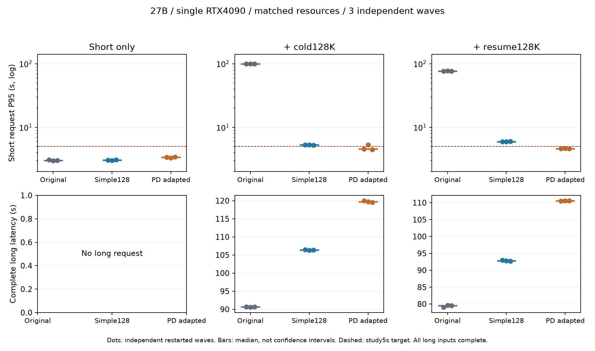

# 简单调度与开源 PD 机制的实测验证

简单策略可以解决大部分长短请求干扰；“简单策略没用”不成立。适配后的 SGLang PD-Multiplexing 进一步改善多数波次的短请求延迟，但当前配置没有同时满足短延迟、长任务代价和吞吐三个标准。这是一个已测得的权衡，尚不足以宣称所有现有方法都解决不了，或已形成论文创新空白。

## 正式三轮结果

每个格子是三次独立重启波次的范围；长任务代价、吞吐变化采用三波中位数之比，不人为配对。冷混合、续接混合均有一条约 128K 长请求；纯短组没有长请求。

| 配置 | 纯短 P95 / 秒 | 冷混合短 P95 / 秒 | 续接混合短 P95 / 秒 | 长任务代价：冷 / 续接 | 输出吞吐变化：冷 / 续接 |
|---|---:|---:|---:|---:|---:|
| 原策略 | 2.965–3.062 | 99.165–99.379 | 76.407–76.992 | 基准 | 基准 |
| 简单 responsive128 + owned-row credit | 2.997–3.075 | 5.231–5.304 | 5.925–5.962 | +17.35% / +16.76% | +4.67% / −1.19% |
| PD-Multiplexing 适配组合 | 3.292–3.398 | 4.464–5.266 | 4.608–4.648 | +32.10% / +39.07% | −5.63% / −15.03% |



正式选中 27 个完整波次，666/666 次严格工具校验通过，18/18 条长请求完整完成，零错误、零截断。冷混合 PD 的三个 P95 分别为 4.559、5.266、4.464 秒，因此不能说“稳定低于 5 秒”。原策略混合组每波仅 9 个请求在固定 48 秒内完成严格校验，简单策略为 22 个；最终全部完成的统计包含 drain 时间。

本研究标准是：所有重复的短 P95≤5 秒、长完成耗时中位数增加≤25%、输出吞吐损失≤10%。简单策略满足后两项，但混合组短 P95 未达标；PD 的长代价和续接吞吐未达标，冷组还有一次 P95 超标。5 秒等门槛是研究标准，并非从企业流量测得的 SLA。每波只有 24 个短请求，不能据此声称生产 P99 或发生频率。

完整逐波统计与实际运行、冻结输入审计见[最终对照](../../results/pd-strategies/final-export/selected-comparison.json)。正式来源是 matched-formal-r1、simple-formal-r2、simple-formal-final-r3、pdmux-private-main-v1 四个 campaign。首轮后来在另一 PD 配置中断，已完整结束的原策略和简单策略六组通过逐组审计后保留；旧 PD 的完整纯短及不完整冷组仍在原始导出中，但不属于上述选中 27 波。

## 负载与匹配条件

单张 RTX 4090（GPU1），既有 RedHatAI/Qwen3.8-27B-INT4 权重，revision `91bd022d5b49442a868bc35008f6c21e1860edfa`，权重文件总计 18,603,387,656 字节。实际架构是 `Qwen3_5ForConditionalGeneration`，64 层含 48 层 GDN、16 层完整 Attention。SGLang 0.5.19、Torch 2.13/CUDA 12.9，TP1/PP1、纯文本、C4、MTP0、W4A16/group128、FP8 Attention KV、BF16 SSM。代码与工具门槛验证功能，不等于完整质量评测或 BF16 SSM 无损证明。

冻结短历史实际 24568 token，长冷输入 131060、续接输入 131049 token。短请求以 0.5 RPS 到达 48 秒，长请求在第 16 秒加入；`resume-high` 是历史组名，此处实际仍为 0.5 RPS。每组独立重启、代码检查、四条 24K 工具预热；混合组的长请求必须完整完成。到达使用开放负载，服务并发硬上限 C4。

正式三路统一实际 131328 KV token、16 个 BF16 循环状态槽、128MiB FlashInfer workspace、`extra_buffer`、普通 overlap 关闭、CUDA Graph 关闭。正常策略保留 mixed batching；PD 按其调度要求关闭 mixed batching、使用独立 P/D 流。后者是机制差异，所以这不是单独改变 SM 数量的因果消融。所有实际池、上下文、并发、精度及冻结请求规格均逐波检查，不能只看启动参数。

短历史已预热。简单策略冷混合每波 24 个短请求均报告 24512 API 缓存 token、56 个未缓存 token；部分控制组缓存计数缺失。缺失不补零，API 未缓存数不等于物理 GPU 重算量。准入策略还可能改变前缀保留，这些收益不能全部解释成带宽或 SM 隔离。冷短请求、较大工具增量、长输出、真实多 Agent 轨迹和更高并发尚未覆盖；这里也没有测出 roofline 带宽上限。

PD 正式波次的 200ms 健康生命周期采样最小空闲显存仅 174–180MiB。这说明当前配置余量小；采样不能排除更短暂峰值。

## 简单策略验证了什么

保持 512-token 轮预算，queue128/256 在有等待请求时缩小正在进行的长块，归还余量供新请求准入。responsive128/64 在已有活跃 decode 时也保持小块。无竞争时仍用原预算。始终保留容量检查和单一未完成 chunk；不能为了短请求收益丢弃或无限搁置长请求。

第一组筛选用 152000 KV / 12 SSM，单轮原策略冷/续接短 P95 为 97.002/71.955 秒；queue128 为 12.483/25.540 秒，queue256 为 38.494/51.670 秒；responsive64 为 10.436/14.858 秒。这些是筛选数据，不与后来资源不同的正式组混算收益。

实际源码中，继续 prefill 的请求已经持有请求行，普通候选数与空闲行比较却没有扣除可复用行。增加 owned-row credit，同时钳制 C4 硬上限、保留 PP 预算和 beam 路径后，更多请求真正放行，暴露 12 槽 Mamba 缓存分配不足。崩溃保留为失败，不能算吞吐。

将静态资源调整为 140000 KV / 16 SSM 后，匹配原策略冷组短 P95=97.024 秒、长耗时 88.380 秒；responsive128 为 5.263/101.670 秒，responsive64 为 5.168/112.101 秒。64 的长代价约 26.84%，故选择 128 做全新正式重复。随后为匹配 PD，再统一到前述 131328 池和 eager buffer，重新跑正式对照。没有引入新的 KV 管理机制。

原生事件表明，正式简单策略在长请求首次 NEW 成功准入至最后 chunk 准入之间，放行了 15 个新短请求；对照为 0。最后 chunk 准入并非 GPU prefill 完成时刻，chunk 的 prefix 长度也可能只是进度。见[原生准入审计](../../results/pd-strategies/final-export/native-admission-final.json)。

## 开源 PD 的适配、失败和执行证据

采用实际 SGLang [PD-Multiplexing 实现](https://github.com/sgl-project/sglang/issues/10813)，保留 SM 分区、CUDA Green Context 流及层间交错。它是可运行的开源先进基线，不是已证明的全局最强方案。增加当前 Dense Qwen 的 split-prefill 入口：区间 0 重置 residual，后续保留 hidden/residual，最终 norm/logits 各执行一次，拒绝不支持的执行模式。

所有适配都在 HDD 的独立、不可变源码 overlay 中完成，未修改全局安装、共享模型配置或驱动。重要失败按发生顺序保留：

1. 原路径要求关闭 token chunk 和普通 overlap；完整输入 prefill 在最小 131328 池仍未通过四路 24K 预热：申请 240MiB 时只余 109.62MiB。140000 池更早在代码门槛申请 20MiB 失败。不能因此判断方法无效。
2. 单独标注的 token512 分块组合复用正常 stash/filter 状态转移、同步流交接，首次完整模型预热在 FlashInfer decode 计划中报 invalid device context。[CUDA 文档](https://docs.nvidia.com/cuda/archive/12.8.1/cuda-driver-api/group__CUDA__GREEN__CONTEXTS.html)说明创建 Green Context 不会使其自动成为 current；增加显式 scoped binding/恢复。固定资源的完整模型 A/B 中，不绑定再次失败，绑定通过代码、四路工具预热和完整 128K 工具请求（87.750 秒）。小数值探针三种模式全部通过，没有单独复现根因。见[资格证据](../../results/pd-strategies/compatibility/green-context-model-qualification.json)。
3. 8192 默认层预算在混合波次完成 9 个短请求后停滞。它不是有效性能样本。源码 `forward_count=budget/extend_tokens` 意味着 128-token 块可一次跑完 64 层；将预算改为 2048，在 P/D 共存时最多跑 16 层。定时 Python 栈诊断自身在代码门槛 SIGSEGV，不能据此解释原停滞；移除诊断后的干净 l16 完成一波，短 P95=4.688 秒、长 119.163 秒。
4. 当前 compressed-tensors WNA16 每个 scheme 共享一份 Marlin workspace，CUDA 模板将它用作全局 barrier 锁。显式每流独立锁区规避源码并发风险，同流复用、按 scheme 隔离、分配失败可重试；但未证明这是原停滞的根因，未隔离的干净 l16 也曾完成。见[源码审计](../../results/pd-strategies/compatibility/marlin-concurrency-audit.json)。
5. 私有锁区下，96/32、112/16、104/24 三个 SM 分区冷组单轮 P95=4.518、4.580、4.541 秒，长耗时约 119.3–120.0 秒；差异不足以做统计排名。4096/l32 中间预算 P95=5.694 秒，没有改善。选择 96/32、2048/l16 后做了全新的三轮正式重复，筛选波次未计入。

另跑一次独立 profiler 波次，实际 GPU trace 有 29728 个 kernel 事件。GDN chunk-prefill 与 recurrent-decode 标志分别定位到不同 context/stream；约 2.071 秒 trace span 内检测到 44.577ms 的 kernel 时间重叠。这是 P/D 确实发生 GPU 并行的正证据，不能换算成带宽占用率、正常运行并行比例或普遍进展保证。profiler 波次短 P95=8.608 秒，扰动明显，已排除正式性能统计。见[重叠证据和 trace SHA](../../results/pd-strategies/profiling/gpu-overlap-evidence.json)，原始 trace 保留 HDD。

MorphX 本轮没有取得新的正确性合格结果，不能将此前移植未通过写成效能负结论；DuetServe 等未部署实现也没有被“实测击败”。本工作回答的是当前实际适配路径，不是所有 SOTA 的上限。

## CUDA Graph 的补充资格检查

为避免仅以 eager 消融推断实际部署上限，额外检查 decode CUDA Graph（max BS4，prefill Graph 关闭），资源、模型、精度及 C4 相同。以下各一波，均不属于三轮正式统计。

| 配置 | 实际 decode graph 显存 | 代码/四路预热/完整冷混合 | 短 P95 / 秒 |
|---|---:|---|---:|
| 普通 responsive128 | 0.111GiB | 通过，25/25 严格工具、完整长请求 | 5.252 |
| PD v8 | 未完成 capture | 第二 Green 流 capture_prepare 的 invalid device context | 无有效性能 |
| PD v9：绑定实际 capture stream context | 0.283GiB | 通过，25/25 严格工具、完整长请求 | 136.526 |

v8 失败时尚有约 0.51GiB，并非已证实 OOM。v9 的上下文修正通过回归和实际捕获，但端到端效果差。该波长输入活跃时仅 2 个新短请求准入；22.143 秒处出现 24568-token 短请求零前缀命中，超过当时 384-token 余量，同一候选被 OTHER 拒绝 959 次。同期日志大量显示空闲 3 行、持有 1 行、硬上限 4，不能归因于无空闲请求槽。

因此 v9 同时出现前缀复用/准入行为变化，不能断言 CUDA Graph 的计算本身导致百秒延迟。前缀是被驱逐还是 SSM checkpoint 生命周期变化，尚未定位。SGLang 也对 Torch>2.6 的 Green Context+Graph 性能有提示；本环境是 Torch2.13，不能据此泛化。没有继续扩大参数网格、修改全局依赖或用失败波次冒充正式重复。原始启动参数、Graph 显存和故障见[全研究导出](../../results/pd-strategies/final-export/all-study-summary.json.gz)。

## 研究判断与可复现记录

目前最稳妥的工程结论是：先做好普通准入、小块响应和实际状态容量，再评估 P/D 并行。现有简单机制已经消除了绝大部分干扰；当前 PD 组合改善短响应，需要付出显著长任务代价。仍待解释的是如何在有限状态/显存余量下，同时保住长输入进展和短历史复用，而不是直接设计新的三级存储结构。

这个候选问题值得继续验证，但至少还需真实 Agent 的缓存命中/工具增量分布，以及普通动态块预算或已有策略的可行域对照。尤其 5.3 秒与 5 秒只差很小，不能用任意阈值制造创新；需要看整条延迟—长进展—吞吐曲线及跨负载稳定性。本轮没有证据宣布“简单方案无解”或“物理带宽墙”。

[最终导出清单](../../results/pd-strategies/final-export/final-export-reproducibility.json)记录两次独立严格导出的四个文件逐字节一致，正式来源 210 个、全研究 585 个原文件重新校验 SHA/字节数；profiler 单独排除。全研究导出包含 28 个 campaign、85 组状态和 1649 条已观测请求，包含失败、部分组与筛选，不能当作有效比较样本数。压缩 summary 为确定性 gzip，内含原始响应统计、配置、失败状态和源文件 SHA；原始事件/日志/权重仍在 HDD。

[源码归档](../../results/pd-strategies/reproduction/README.md)保留五份关键 overlay 的精确 patch、运行时、manifest 和完整文件 inventory，均从固定安装基线重建后核对全部 4372 个文件。保留 patch 的原始空白以确保 SHA 一致。配置在 [pd-strategies.json](../../configs/pd-strategies.json)；执行辅助脚本、账本、测试日志和最终评审随 execution 归档。

服务器路径均在 `/home/guokc/mypro/gnn-mount-sda1/InferX`。以下只读重算不会接触 GPU 服务；不要对已有导出目录覆盖写入：

```sh
source /home/guokc/mypro/gnn-mount-sda1/InferX/env.sh
cd "$INFERX_ROOT/code-pd-baselines"
export PYTHONPATH="$INFERX_ROOT/code-pd-baselines"
"$INFERX_ROOT/repo-venv/bin/python" -m scripts.analyze_pd_baselines \
  "$INFERX_ROOT/pd-strategies/formal-index-final" \
  "$INFERX_ROOT/pd-strategies/formal-reexport-doc-check-v1"
"$INFERX_ROOT/repo-venv/bin/python" "$INFERX_ROOT/pd-strategies/analyze_formal.py" \
  "$INFERX_ROOT/pd-strategies/formal-reexport-doc-check-v1/summary.json" \
  "$INFERX_ROOT/pd-strategies/selected-reexport-doc-check-v1.json" sglang-pdmux-private-best
```

正式 GPU 重跑使用 `scripts.run_pd_baselines`、全新 run-id 和 `--repeat 3`，选中三个 case 为 `sglang-ctx-control`、`sglang-ctx-responsive128`、`sglang-pdmux-private-best`，需要原有服务空闲及控制器完整所有权检查。Graph 资格检查使用已捕获的辅助 `scripts.run_pd_debug`，由它追加 `diagnostic_extra_flags`；普通主入口不解释这些诊断字段。源码重建先按 reproduction README 校验 inventory。绘图用独立 HDD analysis-venv，依赖见[绘图环境](../../results/pd-strategies/final-export/analysis-environment.txt)，没有修改 SGLang 环境。

最终 GPU1 恢复为原 NInfer 256K/MTP7/C1/rk4v4-e8 服务；双 manifest、实际 PID/UID/executable/start ticks、完整 argv 一致，OpenAI 与 Anthropic 工具往返均通过，见[服务验证](../../results/pd-strategies/service/final-service-verification.json)。该记录 PID 为 3604352，今后读取当前 manifest，不能把此 PID 当作永久值。GPU0 由用户主动停止，未重启。
