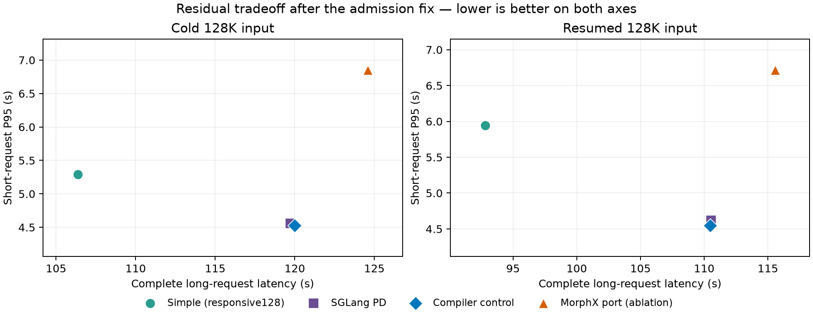

# 4090 / 27B / 128K：MorphX 适配与 SOTA 对照

三轮独立混合实验已经完成，300/300 条请求严格通过。MorphX-on-SGLang 最佳移植消融在冷长/续接组的短 P95 为 6.85 / 6.72 秒，相同编译器对照为 4.53 / 4.55 秒；完整长请求也分别约慢 3.8% / 4.6%。各自单独基准也已补齐：移植版短请求慢化约 1.85 / 1.81 倍，对照约 1.53 / 1.54 倍。**这条移植路径没有改善联合权衡，但还不能据此判断原版 MorphX 的性能上限。** 独立时间线显示控制小拷贝密集、实际 P/D 重叠少，需先排除移植成本。

研究问题是：在一张 4090 上，完整 128K 长输入与交互式短调用共存时，能否同时改善短调用尾延迟、长请求完成时间和吞吐。原来约 100 秒的队头阻塞已有简单修正，不能再把这一软件路径本身当作创新。需要比较修正后的资源代价，而且不能把不可消除的工作量竞争误写为机制缺陷。

之前三轮与单独执行补测显示：简单 responsive128 的短 P95 约为单独执行的 1.78 / 2.00 倍，长请求增加 20.9% / 15.4%；PD 适配组合短请求约 1.50 / 1.52 倍，长请求增加 35.8% / 34.9%。两列分别为冷长、续接长。单独执行补测每配置/组只有一轮，所以这些是诊断比值；不能将小差异解释为统计显著。原数据保持在 [先前报告](2026-10-15-pd-strategies.md) 和 [补测对照](../../results/sota-validation/references/previous-solo-comparison.json)，本次另做同配置的单独基准。

本组短请求只持续到第 46 秒，之后主要测长任务排空；它验证长预填充进入交互负载的干扰，不能代表持续高并发、128K 常驻解码或真实多 Agent 流量。后续需要在完整长上下文阶段仍有新请求到达的匹配实验，并区分物理容量约束与可消除的调度损失。

本轮仍固定 GPU1、一张 4090、相同 RedHatAI INT4 checkpoint、MTP0、eager、C4、131328 Attention KV token、FP8 KV、16 个 BF16 循环状态槽。模型实际为 64 层的 Qwen3_5 混合架构，含 48 层 GDN、16 层完整 Attention。每组独立重启，通过代码检查和四路 24K 严格工具预热，再提交 24 个短请求与一个完整长请求。短输入实际 24568 token，冷长 131060、续接长 131049；0.5 RPS、48 秒、长请求第 16 秒到达。保留原请求和工具期望，不以缩短长输入取得收益。

**实际适配的范围。** [MorphX 作者仓库](https://github.com/thustorage/MorphX) 固定 `4404aed4c180ad83c31179e1ce08ae2234390853`。作者公开 PD 编排依赖准备环境中的私有 vLLM 接口；本轮采用标注为 **MorphX-on-SGLang** 的移植，SGLang 提供已验证的混合模型状态、共享权重、准入和分层执行。两个 P/D CUDA 流均属于 primary context，SM 调整由实际 MorphX runtime 的 `schedule_2` 完成。

实际 MorphX LLVM pass 生成原 kernel 和 `_pk` morphable 入口，Triton 3.7.1 IR 经保守兼容处理进入 LLVM18；INT4 Marlin 也实际重新编译。完整编译器对照使用同一批模块的原入口。FlashInfer/cuBLAS 等原生库仍有未变换路径，不能把观察到多个变换 kernel 名称等同于 100% 时间覆盖。

本机没有可用 gdrdrv。最终候选将 GPU 进度计数器保留在 VRAM，以独立 CUDA copy 流和线程私有 pinned staging 访问；这与作者 GDRCopy 控制延迟不同。先前 mapped-host GPU atomic 版本的独立计数探针明显慢，已保留为失败/诊断路径，未拿它的模型延迟评价作者效能。CUDA-copy 的独立时间线诊断见下文，不能把适配开销写成原方法的性能上限。

适配中实际修正并验证了 extended/cooperative launch 属性保留、per-thread proc-address 语义、128 SM 非整除 profiler wave 计数，以及上游 float32 名称误跳过。独立 Cooperative oracle、GDN 数值测试、Triton 向量和 Marlin 对原 NVCC 数值比较均有实际输出。另一个 NInfer GQA 几何仍未通过，保留为不合格分支；本轮 SGLang 的完整代码、四路 24K 和 128K 工具门槛通过，并不意味着所有算子/模型都已合格。证据见 [资格记录目录](../../results/sota-validation/qualification/)。

**预先声明的三种设置，单轮完整冷混合诊断：**

| 配置 | 短 P95 / 秒 | 完整长请求 / 秒 | 完整波次输出 token/s | 48 秒内严格完成 |
|---|---:|---:|---:|---:|
| 相同编译器、primary P/D 对照 | 4.534 | 119.874 | 9.653 | 22/25 |
| MorphX，默认 split=60 | 7.330 | 195.849 | 6.192 | 21/25 |
| MorphX，split=96 | 7.418 | 160.775 | 7.420 | 21/25 |
| MorphX，96，关闭启动时 CI 限制 | 6.735 | 124.555 | 9.332 | 22/25 |

最后一项保留 agent 的实际动态调度，只关闭启动时 CI 限制，属于明确标注的消融。三种 MorphX 设置中，它的短延迟、长耗时、完整波次吞吐均最好，故在正式重复前冻结；编译器对照仍在这三项中均更好。这是选择依据，不是最终统计。100/100 测量响应均从原始 SSE 重建工具并核对完整输入，无拒绝、错误或截断。[冻结配置](../../configs/sota-validation.json) / [逐波审计和 SHA](../../results/sota-validation/diagnostic-export.json)。

正式实验按每配置分别做三轮独立冷长和续接混合，每组独立重启；另在相同 C4 服务上由串行客户端执行 24 个短请求、一个冷长、一个续接长，作为各自的单独诊断。按每轮 P95 的中位数比较，不将相关请求池化成独立重复。另抓诊断 GPU timeline，排除其延迟数据，统计真实 P/D kernel 生命周期重叠和 `_pk` kernel 时间占比。生命周期重叠不能证明 SM 占用率，更不能替代模型实际 DRAM 字节计数。

**正式三轮，每轮独立启动，表中为各轮统计的中位数：**

| 配置 | 冷：短 P95 / 秒 | 冷：完整长 / 秒 | 续接：短 P95 / 秒 | 续接：完整长 / 秒 |
|---|---:|---:|---:|---:|
| 编译器 primary P/D 对照 | 4.526 | 120.000 | 4.547 | 110.475 |
| MorphX 移植消融 | 6.851 | 124.577 | 6.716 | 115.557 |

冷/续接完整波次输出吞吐，对照为 9.644 / 10.370 token/s，移植消融为 9.330 / 9.970 token/s；48 秒内严格完成数的中位数均为 22/25。所有长请求完整完成，零拒绝、错误或截断。200ms 健康生命周期采样下，对照最小空闲显存为 222–226MiB，移植版为 124MiB；采样可能遗漏更短峰值。单独执行保持原 C4 服务，仅串行客户端；每配置/组一轮诊断，混合为三轮，各自分母匹配。[三轮中位数](../../results/sota-validation/formal-medians.json) / [12 波原始数据重建和 SHA](../../results/sota-validation/formal-export.json.gz)。

相对各自单独执行，冷/续接组的慢化如下；单独基准各一轮，不能把微小比值差异当作统计显著。

| 配置 | 单独短 P95 / 秒 | 冷/续接短慢化 | 冷长：单独 → 混合 / 秒 | 续接长：单独 → 混合 / 秒 |
|---|---:|---:|---:|---:|
| 编译器 primary P/D 对照 | 2.959 | 1.530× / 1.537× | 88.471 → 120.000（1.356×） | 81.089 → 110.475（1.362×） |
| MorphX 移植消融 | 3.711 | 1.846× / 1.810× | 92.001 → 124.577（1.354×） | 83.090 → 115.557（1.391×） |

移植版的单独短延迟已经增加约 25.4%，混合后也没有改善短请求慢化；冷长的相对慢化接近，但绝对耗时仍更高。不能只用一个慢化比值掩盖基准成本。总计 452 条诊断/正式/单独请求全部从 SSE 重建严格工具并检查冻结输入。复核后审计要求精确 token 数（24568/131060/131049），并绑定实际 checkpoint/tokenizer/config 字节；全部旧数据再次通过，两次新导出 SHA256 相等，所有指标和原始波次审计均未变化。原导出另存为 v1，当前导出保留分析脚本源码指纹。[完整对照](../../results/sota-validation/comparison.json) / [确定性核验](../../results/sota-validation/comparison-determinism.json)。

API TTFT 为首个非空流式块的到达时间，可能包含工具解析器缓冲，不能直接当作 GPU prefill 结束或纯排队时间。本次没有精确逐 token ITL，也没有推理实际 DRAM 字节计数。

**独立时间线诊断，不计入性能表。** 在另一轮完整冷混合中，以 CUPTI 获取 P/D 流 ID 后抓取约 8 秒 GPU 窗口。25 条请求均通过，但 profiler 导出造成明显扰动，该轮短 P95 达 64.45 秒，所有延迟/吞吐均排除。

| 诊断量 | 实际观察 | 能说明什么 |
|---|---:|---|
| kernel 生命周期窗口 | 8.013 秒，85162 个 kernel | 单个早期混合窗口，非完整波次 |
| `_pk` kernel 累计时间占比 | 79.40% | 主导 Marlin 算子实际被变换；不是端到端覆盖或 SM 利用率 |
| P / D kernel 生命周期并集 | 1.113 / 1.500 秒 | 真实映射的两条流 |
| P/D 生命周期交集 | 6.738 毫秒 | 该诊断窗口的并发较少，不能外推为未插桩整轮并发率 |
| 8 字节 pinned D2H / H2D 控制流拷贝 | 251587 / 85764 次 | 与 CUDA-copy 控制通道吻合；H2D 次数恰为 `_pk` 次数的两倍 |
| `cudaStreamSynchronize` | 338276 次，跨线程时长累计 1.640 秒 | 高频同步值得消融，不能直接算作端到端额外耗时 |

实际日志还记录 242 次非零最小 SM 边界写入，但包含预热且没有逐写入时间戳，不能把全部写入定位到这 8 秒。Profiler 报告 133248 个重复 flow start ID，并使用 runtime correlation 回退；本分析不依赖 CPU/GPU 因果流重建。API 时长可能跨线程重叠、嵌套或包含等待，不能与 GPU 时间相加。窗口中无 kernel 的间隔也不能直接认定为 GPU 空闲或控制线程导致。

因此当前可行动的线索是 **检验 CUDA-copy 轮询、初始化和同步是否压低实际并发**，而非把这些成本归给作者 GDRCopy 实现。需保留实际动态 SM 调整和数值正确性，再以新传输/原传输的完整模型对照检验因果关系。[时间线证据和原始来源 SHA](../../results/sota-validation/profile-evidence.json)。

图中两轴越小越好。Simple/PD 沿用先前已审核的三轮，compiler/MorphX 为本轮新三轮；前后部署 cohort 区分保留，只有本轮 compiler/MorphX 是相同编译器的因果对照。图中没有纸面或不合格方案的虚拟点，也不把中位数当作置信区间。[SVG](../../results/sota-validation/figures/mixed-pareto.svg) / [PDF](../../results/sota-validation/figures/mixed-pareto.pdf) / [绘图输入和 SHA](../../results/sota-validation/figures/mixed-pareto-data.json)。

**其他 SOTA 的证据边界。**

| 工作 | 当前实际证据 | 尚不能得出的结论 |
|---|---|---|
| SGLang PD-Multiplexing | 上一轮完整模型、三轮混合和单独执行补测；实际 GPU 重叠 | 不是所有空间共享方法的上限 |
| MorphX-on-SGLang | 实际 pass/runtime/动态 SM/P-D 流；三轮完整混合、匹配单独基准和另轮 GPU 时间线 | CUDA-copy、部分 kernel 覆盖与编排差异尚不能等同作者性能 |
| [BulletServe](https://github.com/zejia-lin/BulletServe) | 固定作者源码，执行实际 fallback forward 的 CPU 混合模型状态契约探针 | 尚未完成整套 GPU 引擎、INT4、共享权重和跨进程状态适配，效能未知 |
| [DuetServe](https://proceedings.mlr.press/v306/gao26m.html) | 论文已覆盖 attention-aware roofline、按需 SM 切分和异步 dispatch | 尚无本机完整复现，不能说实测胜过它 |
| [EB+](https://proceedings.mlr.press/v306/zhang26eo.html) | 由官方论文 software 链接取得作者代码，固定 `5b6a619b732b8eeaea93c8c726dbe13948920599` | 尚需适配、实机校准和完整模型门槛，不能以旧版 API 导入失败结束评价 |

Bullet 探针特意保留 Attention K/V，只丢弃 GDN 卷积/循环状态，实际 tiny HF 模型的末 token 隐藏态最大误差约 0.04716；保留全部状态的控制与整段执行相差约 4.77e-7。它说明遗漏状态的适配不能接受，并非 Bullet 完整引擎不可适配，更不是效能负结论。[探针范围与数值](../../results/sota-validation/qualification/bullet-gdn-contract-v3.json)。

EB+ 值得继续补入：作者方法根据校准的硬件代价在线选择 exclusive batching 或 mixed batching，直接研究带宽受限 GPU。它已覆盖“按带宽压力切换执行方式”的思路。作者当前 fork 与本机已验证 vLLM0.31 的 Python API 存在差异，后续应保留作者 crossover、阈值与阶段机，将底层状态/分配接口接到当前引擎，而不是用不同算法挂同一名称。[源码审计](../../results/sota-validation/eb-source-audit.json)。

对课题价值的判断应保持在证据范围内：原来约 100 秒的阻塞已有简单修正；修正后保护短请求与长请求代价之间的权衡可重复，但尚未证明超出现有方法或不可避免的资源竞争。当前 MorphX 移植版没有推进联合前沿；只有排除控制传输成本、补上忠实校准的 EB+，并用持续/后期到达负载确认缺口，才有依据选择研究机制。已有工作已覆盖动态 SM、动态 chunk、混合/独占切换，不能把这些操作本身当作创新。

独立复核还发现 CUDA 旧/新 proc-address 自查询 ABI 的兼容边界。源码生成器已修正，按真实四/五参数指针调用的 CPU 回归通过，修正库也在原工具链编译成功；**该新库尚待 GPU/模型重新资格验证，不能直接替换成新性能点**。实测 v2 库、源码 capsule 和旧结果均原样保留，这一未覆盖的调用边界不等于存档模型运行失败。[修正库构建及资格范围](../../results/sota-validation/qualification/query-abi-v4-build.json)。

原始数据、模型、工具链和构建均留在 `vlm-server:/home/guokc/mypro/gnn-mount-sda1/InferX/` HDD。[复现命令、固定源码和二进制清单](../../results/sota-validation/reproduction/README.md) 可核对实验路径；分析代码的 6 个 SHA 与本地源码逐一相符。452 条性能比较请求以外，时间线另有 25 条严格通过请求。

全部 GPU 实验及串行 follow-up 已结束，独立终态检查通过：GPU1 原 256K/MTP7/C1/rk4v4-e8 服务恢复，PID `3779761`、原 argv 和两份 manifest 一致、无活动请求；GPU0 保持用户主动停止的状态。[终态证据](../../results/sota-validation/final-service-verification.json)。之前用户创建的报告补充和 solo 文件 8 项 SHA 均保持原样。
