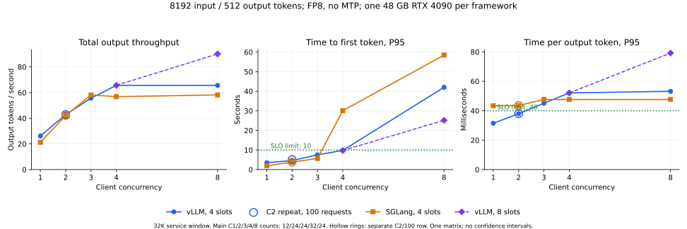

# 官方参考基线：vLLM / SGLang

状态：用户要求停止（2026-10-16）；性能部分已完成，IFBench精度未完成，保留部分结果。正在执行必要的进程停止，不继续实验。按用户最新要求，先对齐根目录Qwen基准文档的8K输入/512输出性能方案，建立FP8无MTP参考基线，再讨论C4优化。第一台运行vLLM，第二台运行SGLang。已完成的NInfer64K、100+8控制独立保留。

## 当前性能比较条件

每条请求精确8192输入/512输出，temperature0、ignore_eos、闭环、2workers、180s超时、同机回环。服务的32768上下文参数是最大窗口，不是本次输入长度。TP1、dtype auto、90%显存、4活动槽、FP8权重/FP8 KV、无MTP；其余使用固定框架版本的原生默认并记录。vLLM按文档参数复现，SGLang使用对应配置。两节点各单张49140MiB RTX4090，CPU不同；跨机差异不当作纯框架因果收益。

| 顺序 | 并发 | 正式请求 | 预热 | 本轮种子 |
|---:|---:|---:|---:|---:|
| 1 | 1 | 12 | 4 | 42 |
| 2 | 2 | 24 | 4 | 43 |
| 3 | 4 | 32 | 4 | 44 |
| 4 | 8 | 24 | 8 | 45 |
| 5 | 3 | 24 | 4 | 46 |
| 6 | 2 | 100 | 4 | 47 |

原版runner文件不改；实验包装器显式替换MD与ZIP不同的参数，保留最终argv、完整raw请求/响应并用原版统计解析器核验。两框架逐档输入文件SHA一致，验证独立输入及缓存命中。TTFT P95≤10s且TPOT P95≤40ms才联合通过。官方未给出引擎版本、具体种子和完整默认值；本轮固定vLLM0.31.0、SGLang0.5.19及种子42–47，不声称逐字节复现官方原始运行。

两机挂载 `/model/ModelScope/Qwen/Qwen3.8-27B-FP8`。[完整核验](../../results/framework-c4/fp8-provenance.json)确认每台67个LFS文件（66个权重及tokenizer）和全部推理配置文件与[官方revision `017b9c7`](https://huggingface.co/Qwen/Qwen3.8-27B-FP8/tree/017b9c7af6b5689d5dd426a76e0bc077eb5ca20a)匹配。README和LICENSE有差异，原始文件未改动，不推断挂载目录下载历史。运行 `python3 results/framework-c4/verify_fp8_provenance.py` 可离线重做元数据核对。

FP8与混合Q4/Q5 NInfer是完整服务栈比较，不能完全归因于调度器。实际FP8计算后端、KV scale、MTP和生成默认逐组记录；所有失败独立保留。

## 运行配置与复现入口

| 项目 | vLLM节点 | SGLang节点 |
|---|---|---|
| 引擎 | vLLM 0.31.0 | SGLang 0.5.19、sgl-kernel 0.4.6.post1 |
| PyTorch | 2.13.0+cu130 | 2.13.0、CUDA 13 |
| Transformers | 5.17.0 | 5.12.1 |
| 实际FP8权重计算 | SM89 Marlin，weight-only路径 | Triton W8A8 block-FP8，默认shape配置 |
| 原生prefill预算 | 2048 | 4096 |
| 前缀缓存 | 开启，逐档核验零复用 | 开启，原生日志核验零复用 |
| FP8 KV scale | 检查点无对应scale，使用1.0 | 检查点无对应scale，使用1.0 |
| Chat默认 | thinking开启，temperature1/top_k20/top_p0.95 | thinking开启，temperature1/top_k20/top_p0.95 |
| 服务seed | 性能/质量均为原生0 | 原生自动seed：性能200168196，质量939327890 |

性能走completions接口并显式temperature0；表中的Chat默认用于另行测量的IFBench。两框架的实际FP8计算不同，不能把同名FP8直接等同为相同算子或计算精度。

原始启动参数：[vLLM](../../results/framework-c4/vllm/document-literal-launch.json)、[SGLang](../../results/framework-c4/sglang/official-native-32k/command.json)。实验包装器：[vLLM](../../results/framework-c4/vllm/run_document.py)、[SGLang](../../results/framework-c4/sglang/official_operator.py)，均调用未修改的官方helper。`results/`中的操作脚本保留本轮主机身份断言；迁移时需按目标机器重新盘点和绑定身份，公共部署工具不以云机器名命名。

两节点使用隔离Python 3.12环境和已有GCC/G++13.4工具链。启动曾因venv PATH、nvcc宿主编译器和libstdc++版本失败，后通过显式环境路径解决；没有修改引擎kernel源码。安装重试、启动失败和最终环境分别保留，不能将早期失败配置当作本表的实际运行配置。

## 完整六档参考结果

| 来源 | 并发 / 正式数 | TTFT P95 (s) | TPOT P95 (ms) | 输出token/s | 数值联合SLO |
|---|---:|---:|---:|---:|---|
| 官方参考 | C1 / 12 | 3.481 | 31.441 | 26.22 | 通过 |
| vLLM0.31.0 | C1 / 12 | 3.484 | 31.490 | 26.17 | 通过 |
| SGLang0.5.19 | C1 / 12 | 1.926 | 43.334 | 21.29 | 未通过 |
| 官方参考 | C2 / 24 | 5.023 | 37.909 | 42.96 | 通过 |
| vLLM0.31.0 | C2 / 24 | 4.619 | 37.979 | 42.88 | 通过 |
| SGLang0.5.19 | C2 / 24 | 3.801 | 43.570 | 42.14 | 未通过 |
| 官方参考 | C4 / 32 | 9.395 | 51.992 | 65.78 | 未通过 |
| vLLM0.31.0 | C4 / 32 | 9.783 | 52.121 | 65.62 | 未通过 |
| SGLang0.5.19 | C4 / 32 | 30.075 | 47.669 | 56.83 | 未通过 |
| 官方参考 | C8 / 24 | 41.822 | 53.106 | 65.79 | 未通过 |
| vLLM0.31.0 | C8 / 24 | 42.027 | 53.211 | 65.64 | 未通过 |
| SGLang0.5.19 | C8 / 24 | 58.481 | 47.659 | 58.18 | 未通过 |
| 官方参考 | C3 / 24 | 7.499 | 44.974 | 55.82 | 未通过 |
| vLLM0.31.0 | C3 / 24 | 7.526 | 45.071 | 55.69 | 未通过 |
| SGLang0.5.19 | C3 / 24 | 5.686 | 47.658 | 58.18 | 未通过 |
| 官方参考 | C2 / 100 | 4.608 | 37.905 | 42.98 | 通过 |
| vLLM0.31.0 | C2 / 100 | 5.109 | 37.978 | 42.89 | 通过 |
| SGLang0.5.19 | C2 / 100 | 3.814 | 43.567 | 42.14 | 未通过 |

vLLM六档TPOT与文档参考相差约+0.15%至+0.25%，吞吐相差约−0.18%至−0.25%；TTFT差异较大，范围约−8.0%至+10.9%。本轮vLLM最大通过并发为C2，C3/C4的TPOT已经超标；C8还超出TTFT限制。基线数值接近与C4优化成功是两个独立结论。

SGLang本轮最高总输出吞吐约58.18 token/s，单请求约21.29 token/s；六档均未通过TPOT限制。两组C2的结果接近，但整体仅运行一次矩阵，尚不据此宣称跨环境稳定排名。 C4下SGLang的TPOT47.67ms略低于vLLM52.12ms，但TTFT30.07s显著高于9.78s；“TTFT快而decode慢”只描述低并发的相对结果，不能概括全部档位。

SGLang单请求TPOT已超过40ms，不能将其全部解释为其他请求prefill干扰。当前实际计算后端不同：vLLM在SM89选择FP8权重的Marlin路径，SGLang选择Triton W8A8 block-FP8默认kernel配置。C1的prefill/decode取舍可能与这些路径有关，但需要同引擎受控实验才能归因；GPU利用率不能证明带宽roofline。两者都已开启chunked prefill，实际默认预算分别为2048与4096，单纯“打开chunked prefill”不是新增修复。 SGLang该版本还提供`SGLANG_FORCE_FP8_MARLIN=1`支持block-FP8权重的Marlin路径，可作为后续计算后端对照；本轮未运行，不能据此填写性能或质量收益。

离线重算：`python3 results/framework-c4/verify_reference_rows.py`，输出[逐档核验](../../results/framework-c4/reference-row-verification.json)。六档×两框架共12组已全部通过请求、原版解析和实际输入集合核验，432条正式请求、56条预热，零请求错误；质量与整批终态仍在进行。

图中空心圆为单列的C2/100复测；其余点保留各档原请求数。连线仅用于阅读，一轮结果不提供跨轮置信区间。[绘图脚本](../../results/framework-c4/plot_performance.py)直接读取已核验数据，使用matplotlib3.10.7。

## vLLM 8活动槽对照

保留4槽参考，在新服务中只把`max-num-seqs`设为8，重复同一C4/C8的输入、种子、正式/预热计数和测量方式；[配置差异](../../results/framework-c4/vllm/capacity8-resolved-config-comparison.json)记录了由此引起的graph捕获范围和KV容量变化。

| 客户端并发 | 服务活动槽 | TTFT P95 (s) | TPOT P95 (ms) | 输出token/s | 联合SLO |
|---:|---:|---:|---:|---:|---|
| 4 | 4 | 9.783 | 52.121 | 65.62 | 未通过 |
| 4 | 8 | 9.753 | 52.089 | 65.66 | 未通过 |
| 8 | 4 | 42.027 | 53.211 | 65.64 | 未通过 |
| 8 | 8 | 25.169 | 79.219 | 90.11 | 未通过 |

C8吞吐提高约37.3%、TTFT下降约40.1%，但TPOT增加约48.9%；放开服务端并发没有让C8通过SLO。C4几乎不变，不能将其TPOT超标归结为4槽上限。两组的实际预热/正式输入集合与原4槽对应档位相同，[独立核验](../../results/framework-c4/capacity8-verification.json)包含全部68条请求。

## SGLang请求准入疑点

C3/C4/C8的TPOT P95均约47.66ms，但TTFT P95从5.69s增加到30.07s、58.48s。间隔40步记录的原生decode日志中，C4/C8大多只有3个请求运行且队列非空；同一波客户端请求的完成时序也显示分批等待。这些日志包括预热，不是每个forward的完整轨迹。

[源码与日志分析](2026-10-16-sglang-admission.md)发现具体候选原因：最后一个prefill chunk复用已经分配的request row，却仍计入`can_run_list`与空闲行数的比较，在“2个decode+1个续接chunk+1个等待请求”时可能提前设置`batch_is_full`；合并成3个decode后，标记持续阻止准入，直到请求完成。8个相关源码文件与固定wheel逐字节一致，但本轮没有记录该分支操作数，故仍是待插桩确认的原因，未宣称修复或性能收益。Mamba状态使用率采样最大约0.27，不支持将它归因于状态池持续耗尽。

## GPU采样边界

[独立资源审计](../../results/framework-c4/gpu-resource-audit.json)保留原始结果：12组参考中11组单独CSV覆盖通过，8槽的两组均通过。SGLang C8最后一条采样比正式请求结束早约0.080秒，严格按该行CSV检查缺少末端之后的采样，因此失败状态保留。

紧接着C3行的首条真实采样可补齐该边界，两条相邻采样间隔1.903秒，小于5秒阈值。[补充核验](../../results/framework-c4/gpu-boundary-verification.json)绑定两份原始CSV哈希，只拼接这条真实采样，未插值、未修改原文件；正式窗口内统计完全不变。联合轨迹覆盖通过，不将它改写成“原C8 CSV独立完整”。资源均值和极值只描述已记录采样点。 [vLLM时区记录](../../results/framework-c4/vllm/timezone-evidence.json)与[历史采样/epoch对齐](../../results/framework-c4/vllm/gpu-timezone-correlation.json)、[SGLang时区记录](../../results/framework-c4/sglang/timezone-evidence.json)支持按UTC解析。vLLM的时区环境在性能结束后采集，历史一致性由各档保存的epoch与采样时刻相符补充支持，不能称为当时已保存的全部sampler环境。

正式窗口内已记录采样点的资源统计：

| 配置 | 客户端并发 | 显存最大值 (MiB) | 功率点均值 (W) | 温度最大值 (°C) | SM时钟范围 (MHz) |
|---|---:|---:|---:|---:|---:|
| vLLM / 4槽 | 4 | 43110 | 375.81 | 75 | 2565–2655 |
| SGLang / 4槽 | 4 | 47229 | 366.02 | 71 | 2475–2670 |
| vLLM / 4槽 | 8 | 43110 | 375.85 | 75 | 2565–2655 |
| SGLang / 4槽 | 8 | 47229 | 366.89 | 71 | 2445–2670 |
| vLLM / 8槽 | 4 | 43082 | 375.85 | 75 | 2550–2655 |
| vLLM / 8槽 | 8 | 43082 | 401.94 | 77 | 2580–2655 |

显存包括引擎预分配池，不能把已占显存直接等同于活动请求使用量。当前采样没有显存带宽计数器，也没有完整kernel时间线，因此不据此声称已达到带宽上限或排除所有瞬时节流。

## 已完成的NInfer控制（独立协议）

两台先前完成的控制采用ZIP口径：64K窗口、8活动槽、MTP4、2048分块、int8 KV，C4各100正式+8预热、600s超时、seed42。固定数据SHA `bcfec27543e2eb2a9695cd998fa505fa091264ad0e5abed06989d1a43084adbc`。不能将它们与本轮MD配置说成同配置调度消融。

| 节点 | TTFT P95 (s) | TPOT P95 (ms) | 输出token/s | 完整性 | 联合SLO |
|---|---:|---:|---:|---|---|
| vLLM实验节点的NInfer控制 | 7.107 | 46.178 | 94.81 | 100/100、零错误、8192/512 | 未通过 |
| SGLang实验节点的NInfer控制 | 6.951 | 45.790 | 94.82 | 100/100、零错误、8192/512 | 未通过 |

## 之前探索的作用

- 原生计时与源码核对已把NInfer秒级等待定位到prefill/decode串行交替，并识别“首token前排队”和“输出过程中被其他prefill拖慢”的不同影响。这为后续chunk预算、decode执行机会和MTP组合实验提供依据；本轮先完成官方参考配置基线。
- 已有模型获取、身份安全的服务控制、长输入/输出长度验证、原生评测与错误归档方法可以直接复用。
- 之前48K以上混合长短请求、eager/MTP0、PD/MorphX/EB+/QoServe实验的收益，不能直接当作8192/512、CUDA Graph/MTP配置的比赛成绩；它们提供假设和对照方法，具体收益仍由本轮测试决定。

## 与赛题文档精度表的关系

直接比较对象为根目录[Qwen基准文档](../../Qwen3.8-27B基准测试.md)，原表与哈希保存在[精度参考记录](../../results/framework-c4/quality-reference.json)。文档IFBench前100、batch2、只显式设置max_tokens32768，与我们原版评测的这些设置相同。

| 文档中的原始列名 | 文档score |
|---|---:|
| Qwen3.8-27B-FP8 (With MTP) | encounter infinite thought loop |
| Qwen3.8-27B-FP8 (Without MTP) | 80% |
| Qwen3.8-27B (With MTP) | 76% |
| Qwen3.8-27B-FP8 (Without MTP) | 76% |

两个FP8 Without MTP列名重复且分数不同，score没有注明strict/loose或prompt/instruction；未标量化的Qwen3.8-27B列不能仅凭名称推定精度。文档也没有给出精度测量的EvalScope版本、思考模式、实际采样默认值及数据revision/hash。因此不能声称完整复现了其精度设置，或把55%到80%/76%的差异归因于某个单项优化。

我们现有同一次IFBench100运行的四个指标为：

| 指标 | 计分方式 | 当前NInfer结果 |
|---|---|---:|
| prompt_level_strict | 每题所有可验证指令严格通过才记1 | 55/100=55% |
| inst_level_strict | 所有单条指令的严格通过率 | 65/111≈58.56% |
| prompt_level_loose | 对有限格式变体检查后，每题所有指令通过才记1 | 55/100=55% |
| inst_level_loose | 所有单条指令的宽松通过率 | 66/111≈59.46% |

四项来自同一个基准和同一批回答，不是四个测试集。它们衡量指令遵循质量；TTFT/TPOT/吞吐是系统性能指标。我们数值低于文档参考，当前量化与MTP/思考配置也不同，不能写成“与文档精度一致”。评分规则要求质量与性能取舍合理，但没有公布IFBench百分比到比赛分数的换算公式或明确数值合格线。

[预测审计](../../results/framework-c4/ninfer-quality-audit.json)确认100条输入和111条指令元数据与冻结记录一致；100条归一化终止原因均为`stop`，输出4–2362 token，没有达到32768上限。因此这一轮的分数差距不能归因于统一输出截断；这不等于单独确定了量化、MTP或思考模式的影响。

本批FP8精度采用独立64K窗口，其余保留对应性能服务的默认配置；不缩减32768输出预算，也不将它与32K性能配置视为同一冻结服务。先校验[同一100条输入与指令元数据](../../results/framework-c4/ifbench100-input-identity.json)，记录实际模板/思考/采样及终止原因。 两框架保留各自原生seed，SGLang在64K服务重启后自动重新取seed；相同数据与采样参数不意味着相同随机采样轨迹，分数差异不能单独归因于量化算子。代表性FP8无MTP的精度不能替代另一MTP配置的精度；声称某配置同时满足SLO和质量时，必须让该冻结配置接受两种测量。

## 待补实测

- 两框架IFBench100质量与真实生成配置、失败/截断情况。
- 服务恢复、完整证据索引、复现命令及独立审阅。
