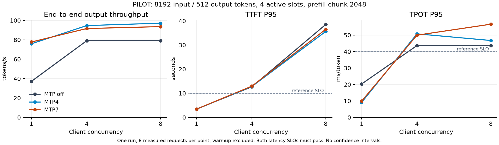

# 单卡 NInfer/MTP 性能与瓶颈验证

状态：两机环境与备用服务已就绪，8种配置、19个档位的小样本筛选完成；第一台正在固定配置下运行原版100请求/档和IFBench100。本文当前数字只属于PILOT，不能替代尚未完成的正式结果。

## 范围与可迁移性

公共工具、配置模板和结果总目录以功能命名，参见[复现说明](../../submission/REPRODUCE.md)。ucloud1/2仅为本轮机器名称。两台都为单卡49,140MiB RTX4090、450W功率上限、同驱动，CPU分别为EPYC7A23和7B13；第一台测量，第二台做功能与重启验证。后续机制必须相对各自同机基线比较，不把两个CPU平台的差异算作优化。

固定NInfer v2权重revision3526913、引擎5c60b7c和本仓completions补丁，完整SHA见[模型清单](../../submission/model-manifest.json)。CUDA13.2.51/GCC13.4原生构建，第二台使用同一构建并核验SHA。严格输入使用权重内嵌tokenizer，真实8192/512、ignore_eos、usage与缓存隔离已验证；chat保留上游缓存。源代码修改只适配API，不改GPU内核或MTP接受规则。

## 首轮消融

同机回环、int8 KV、64K上下文、KV容量131072、活动请求上限4、prefill chunk2048、greedy/no-thinking；MTP开启时使用lm-head-draft。每档2预热+8正式，输入8192/输出512，seed1729，同一原版runner生成的数据与采样策略。原生AIPerf0.13.0执行并由原版解析器核验，全9档数据完整、零请求错误、长度正确。P95是8个请求的插值百分位，尚不能估计稳定尾分布。

| MTP | 客户端并发 | 输出tok/s | TTFT P95(s) | TPOT P95(ms) | 两项SLO同时满足 |
|---:|---:|---:|---:|---:|---|
| 关 | 1 | 37.16 | 3.42 | 20.30 | 是 |
| 关 | 4 | 79.08 | 12.70 | 43.65 | 否 |
| 关 | 8 | 79.09 | 38.51 | 43.68 | 否 |
| 4 | 1 | 75.89 | 3.42 | 9.08 | 是 |
| 4 | 4 | 94.69 | 12.82 | 50.77 | 否 |
| 4 | 8 | 97.14 | 35.61 | 46.74 | 否 |
| 7 | 1 | 77.74 | 3.43 | 9.88 | 是 |
| 7 | 4 | 91.64 | 12.96 | 49.97 | 否 |
| 7 | 8 | 93.61 | 36.50 | 56.64 | 否 |

两项SLO分别为TTFT P95≤10s、TPOT P95≤40ms；这是评分参考口径，原版ZIP的“完整”只代表测量完整性。输出吞吐包含预填充、解码和排队，不能与服务日志中的纯decode tok/s混用。原始数据、失败记录、GPU采样和[可核验汇总](../../results/ninfer-performance/pilot-initial/comparison.json)均保留。

图对应首轮固定活动上限4、分块2048的同机消融；[SVG](../../results/ninfer-performance/pilot-initial/pilot.svg)和[绘图脚本](../../results/ninfer-performance/pilot-initial/plot_pilot.py)一并保留。

观察：MTP7相对关闭MTP的单并发端到端输出吞吐约2.09倍，C4/C8只约1.16/1.18倍。活动上限4时，客户端从C4增加到C8主要增加排队，吞吐近饱和；MTP没有消除长预填充与多请求解码之间的尾延迟。MTP4/7仅一次8请求/档，二者小差异不能写成统计显著的排名，也不能由此推出IFBench质量不变。

仅选GPU利用率>50%的1秒采样点，选中点的利用率均值约99.5–100%，平均功率约429–434W，SM频率均值约2544–2582MHz，峰值温度81–83°C；这些是筛选后的繁忙采样点，不能当作整轮或完整推理时段的均值。首轮全部采样的显存峰值约22.0–23.1GiB。高利用率不足以证明达到DRAM带宽roofline，温度峰值也不足以单独证明热限频。后续采样补充clocks_event_reasons，分开检查预填充计算、解码访存、调度停顿、功率和温度因素。

## 分块与活动请求数筛选

同样每档2预热+8正式、seed1729，补充下表；其余条件与首轮一致。原版解析器核验10档均完整，另外80条正式、20条预热均为8192/512。统计样本少，差异不作显著性判断。[完整原生结果](../../results/ninfer-performance/pilot-refinement/)、[汇总](../../results/ninfer-performance/pilot-refinement/comparison.json)包含全部命令、逐请求和实际等待端口释放记录。

| MTP | 活动上限 | 分块 | C1输出tok/s | C8输出tok/s | C8 TTFT P95(s) | C8 TPOT P95(ms) |
|---:|---:|---:|---:|---:|---:|---:|
| 7 | 4 | 8192 | 74.97 | 92.90 | 37.74 | 53.63 |
| 7 | 8 | 8192 | 73.52 | 97.63 | 29.89 | 66.34 |
| 4 | 8 | 8192 | 72.82 | 93.42 | 29.87 | 69.69 |
| 4 | 8 | 1024 | 77.26 | 100.69 | 29.02 | 65.46 |
| 4 | 8 | 2048 | 76.71 | 101.39 | 27.52 | 63.10 |

扩大分块未提速：MTP7/活动4从2048改为8192，C1吞吐从77.74降至74.97，TTFT P95从3.43增至3.85s。增加活动上限可以减少队外等待，但C8的TPOT尾延迟仍较高。上述所有C8均不满足两项SLO；单纯增大分块/并发尚未解决该负载的延迟问题。

正式选择MTP4/活动8/分块2048、64K上下文、int8 KV、lm-head-draft开启。它是本轮筛选中C8吞吐最高的一组；与1024分块的吞吐差不足1%，不声称显著更优。选择2048也保持首轮分块口径，并有较低的本轮C8 TTFT/TPOT。固定配置用于完整C1/C2/C4/C8和精度，不逐档切换以拼接最优数。正式seed42独立于筛选seed1729。

原生8192分块负载下曾观测到`clocks_event_reasons.sw_power_cap=Active`，同时软/硬热降频标志为Not Active；该单点记录不代表整轮分布，保存在refinement的clock-reasons-snapshot.csv。正式采样包含这些标志，保持驱动/功率设置不变。

## 并发等待的来源

从原生逐请求日志计算`R = total - ttft - decode`，先逐请求相减再取中位数。19档各选profiling时间窗内的8条512-token原生完成记录，排除预热和兼容探针；客户端与原生的“首token之后耗时”中位数在各档相差均小于0.2ms。这里按时间窗和计数交叉核验，未声称有原生/客户端request ID的一一映射。[离线脚本与输入SHA](../../results/ninfer-performance/analysis/latency_decomposition.py)、[完整重算结果](../../results/ninfer-performance/analysis/latency-decomposition.json)可复核。

| 配置 | C1的R中位数(s) | C8的R中位数(s) |
|---|---:|---:|
| MTP0 / 活动4 / 分块2048 | 0.0017 | 10.260 |
| MTP4 / 活动4 / 分块2048 | 0.0011 | 6.834 |
| MTP7 / 活动4 / 分块2048 | 0.0014 | 6.879 |
| MTP4 / 活动8 / 分块2048 | 0.0008 | 11.984 |

固定上游源码中，单个worker交替执行一个prefill分块和一个包含当前decode-ready请求的解码批次，使用同一执行锁；文本prefill分块返回前会同步。某个请求解码期间，其他请求的prefill占用的时间不会计入它的decode计时，用户仍然在等待。反过来，decode计时把共享批次的完整耗时记给每个参与请求，也包含MTP replay/hidden-correction的同步尾部；并发请求的decode计时不能相加当作GPU独占时间。

在恰好8请求/8活动槽的PILOT中，可以进一步把每条请求的R与“比它更晚产出首token的请求，其prefill时间之和”比较。所选MTP4/分块2048中，第一个产出token的请求R为23.972s，对应后来7条prefill之和23.966s；八条比较的绝对差中位数仅6.54ms。1024和8192分块的另外三组同类比较约6.94–7.44ms。日志与源码共同支持：**这些短批次中的额外等待主要来自其他请求的串行prefill**。改变分块和MTP尚未消除这部分等待。

此简单求和只适用于本轮8请求/8槽批次，不能直接套用到有持续补充请求的100请求闭环负载或活动上限4的情形。剩余毫秒差包含未单独计时的控制/发布及计时边界。尚无逐kernel时间线或带宽计数器，不能据此断言GPU空闲、纯CPU阻塞、DRAM roofline，或预测新调度机制的收益。源码定位为固定引擎revision下的`concurrent_executor.h`调度循环、`text_context_impl.h`预填充同步，以及`program_impl.h`的decode与MTP尾部计时。

## 实验工具与部署问题

原版服务缺少raw completions协议，已以CPU原生契约测试和真实GPU探针验证适配；没有伪造token/usage或添加计时用的假SSE首块。完成请求可以把多个MTP token放在同一个事件内，TPOT仍按服务真实token计数的原版公式计算。

连续切换服务时发现HTTP keepalive在服务退出后留下TCP TIME_WAIT，下一次bind会返回EADDRINUSE。首轮的MTP4/7两个case因此没有启动，整体manifest保留failed；随后独立补跑成功，不将它们混同于模型OOM或推理失败。节点2保留了原生因果复现：HTTP连接可复用，身份核验后停止服务并关闭客户端，出现state06、无监听者、bind errno98。通用driver现在仅在本轮已启动且回收的服务之后有界等待端口释放，遇到外来监听者仍立即拒绝，等待不进入性能计时。

启动包装脚本也发生过一次引号语法错误，未进入模型压测，原始失败日志保留。模型镜像429、NLTK代理下载限制、编译缺少zlib.pc均为部署问题，已经分别通过完整SHA核验的节点间复制、核验上游资源归档、隔离安装开发依赖解决；不把这些算作推理瓶颈。

## 尚待完成

- 在第一台以原版runner运行C1/C2/C4/C8各100正式+8预热，以及IFBench前100/batch2/max_tokens32768；保留原生逐请求、质量评分及独立1秒GPU采样。
- 报告正式结果与真实质量案例，更新提交TODO；第二台维持备用，后续优化先与其自身基线比较。

本次工程工作没有自动恢复暂停的MorphX/EB+/QoServe对照，也不等于已经提出或验证新的调度机制。
