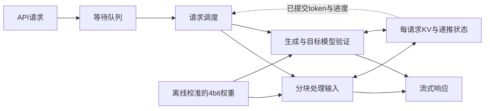

# InferX 技术报告：单卡 Qwen3.8-27B 推理优化

**你说啥都队｜陈文欣、张志雄、郭坤昌**  
代码：[Yuer-yuan/InferX](https://github.com/Yuer-yuan/InferX) · 展示：[答辩PDF](../basic/presentation/main.pdf) · 运行：[部署说明](deployment.md)

InferX 的目标是在一张48GB RTX 4090上，让27B模型同时服务更多请求，并控制用户等待时间。我们基于NInfer改造量化计算、批执行与请求调度，交付了可运行的推理服务和逐请求评测记录。

当前冻结100在客户端14、引擎13下两轮同时满足10秒TTFT与40毫秒TPOT门槛，吞吐分别为 **306.04、309.95 token/s**；C4/8/12/13也有完整通过记录。同一二进制的独立评测105完成IFBench原前100题，严格 **85/100**、宽松 **88/100**，保留1个空最终答案。性能与质量使用不同KV容量及生成协议，实际条件见[当前100/105结果](selected-results.md)。

完整源码、环境安装、构建与实测见[中文复验指南](reproduction.md) / [English guide](reproduction-en.md)。ucloud3从同一c976源码正常重建为664cfbb9，旧缓存C14实测9.896s / 38.286ms、304.897 tok/s；独立原100题严格90/100、宽松96/100，保留1个截断空回答。它与历史e4ed/105分列；新量化缓存另行验证。归档与获取入口统一见[交付清单](../DELIVERY.md)。

## 1. 项目概述

项目交付包含三部分：推理服务与优化实现、性能和任务质量的原始记录、部署及复验文档。服务提供兼容OpenAI格式的接口，支持原始补全、对话和流式输出。

核心工作是让低比特权重参与实际整数计算，并将它接入完整模型；同时处理多请求下的KV缓存、递推状态、投机解码和调度。NInfer引擎、MTP方法及量化方法来自上游，团队贡献是这些机制在目标模型与单卡环境中的实现、适配和验证。

## 2. 问题与目标

大模型推理有两个不同阶段：**预填充（Prefill）**先处理输入，**生成（Decode）**再逐步输出token。长输入与正在生成的请求共享GPU；即使总吞吐提高，个别用户仍可能等待很久。

因此，成功标准同时看三个指标：

| 指标 | 回答的问题 | 本项目判定方式 |
|---|---|---|
| 首字延迟 TTFT | 发出请求后，多久看到第一个token？ | P95不超过10秒 |
| 生成延迟 TPOT | 首token之后，平均多久生成一个token？ | P95不超过40毫秒 |
| 总输出吞吐 | 整个服务每秒输出多少token？ | 在延迟约束下尽量提高 |

P95表示95%的请求不超过该值。每个请求的TPOT先按“生成区间耗时÷后续token数”计算，再取P95；它包含生成过程中的等待。质量使用IFBench原版评分器单独检查，详情见[Benchmark](benchmark.md)。

## 3. 整体方案

我们固定Qwen3.8-27B模型，以可修改底层C++/CUDA路径的NInfer为主要优化载体。量化用于减少大矩阵计算开销，MTP用于一次提议多个token、减少生成轮次，调度用于协调长输入与持续生成。三者需要共同作用。

图中量化权重按所选版本的实际阶段和矩阵路由加载；每个请求分别维护状态。模型、框架与路线的选择理由见[选型说明](model-selection.md)。

## 4. 核心实现

**量化计算。** 从经过核验的逻辑权重出发，使用变换、分组和GPTQ校准生成4bit权重；运行时把激活动态量化为4bit，送入INT4矩阵指令，最后用缩放值恢复数值范围。主线先覆盖前馈网络64层、128个矩阵，再扩展输入和输出投影。指定路径采用W4A4，其余算子保留各自格式。

**多请求执行。** 将批执行扩展至16/32请求时，同步调整工作区、CUDA Graph及每请求状态。投机解码的提议必须由目标模型验证，只有接受部分推进状态；未接受部分按实际实现恢复，避免不同请求或轮次相互污染。

**调度。** 把8192-token输入拆成2048-token块，结合首字时限和生成进度选择下一段工作。后续进一步用单个请求的提交产出估计剩余轮次，改善部分高并发尾延迟。实现和验证细节见[优化方案](optimization.md)。

## 5. 结果与证据

当前100的六组性能测量、失败边界和105质量结果见[当前结果](selected-results.md)。下表保留更早的输出投影量化版本作为历史证据；每轮128个正式请求、8个预热请求，单卡、冷8192输入/512输出，均无请求错误。

| 客户端并发 | 首字P95 / 秒 | 生成P95 / 毫秒 | 总输出 token/s | 两项延迟要求 |
|---:|---:|---:|---:|---|
| 12 | 9.50 | 37.34 | 284.75 | 通过 |
| 16 | 9.93 | 51.70 | 307.15 | 未通过 |
| 32 | 23.69 | 101.16 | 363.58 | 未通过 |

12/16并发来自同一节点，32并发来自另一同规格节点，KV预算随并发调整。12并发是单轮通过证据；重复轮次和稳定容量还需继续验证。

历史076质量评测使用验证阶段扩展版：100题包含111条指令约束，题目严格/宽松评分为84/87，指令严格/宽松通过数为95/98；没有生成错误、空输出或长度截断。该测试与上表的版本、KV和生成协议不同，也不是当前100的评测105。完整历史条件、后续失败候选和原始数据入口见[测试报告](benchmark.md)与[实验索引](experiment-index.md)。

## 6. 工程化设计

复现依赖一组确定的输入：源码、模型、量化缓存、工具链和启动配置。服务启动记录GPU及内存预算，请求日志记录输入处理量、缓存命中、输出数量与耗时，客户端记录实际体验。两侧日志用于交叉检查，材料生成器再逐请求复算延迟。

端口占用、OOM、超时、空输出和截断均保留日志与结果；数值检查、状态检查、完整任务质量和端到端性能分别验证。部署和异常排查见[部署说明](deployment.md)，从取得材料到复测的完整顺序见[复验说明](reproduction.md)。

## 7. 成本、性能与取舍

每轮仅使用一张48GB RTX 4090，功率上限450W。权重之外，KV、递推状态、工作区和CUDA Graph都消耗显存，因此能分配更多请求不等于延迟也能达标。

一个明确的取舍是活动容量：固定16客户端，将同时执行的请求数从16减到12，生成延迟下降10.38%，首字延迟却上升46.37%，两项延迟仍未同时通过。降低生成竞争会增加排队等待，单独限制并发不足以解决问题。其他路线的收益、代价和失败原因见[性能分析](performance-analysis.md)。当前没有完整能耗积分和账单数据，不报告单位token费用。

## 8. 总结与不足

已完成真实4bit计算接入、多请求状态与调度改进；冻结100在客户端14/引擎13下两轮通过性能SLO，同版另有完整100题质量评测。主要不足是更高并发的尾延迟仍偏高，C14通过余量较小；质量与性能使用独立配置，原100题也不代表完整IFBench。

下一步将沿实际执行关键路径优化，增加不同seed和重复轮次，继续验证重建量化缓存；新依赖安装和原数据加载的CPU验证已独立完成。664源码重建与旧缓存实测、新环境验证的各自范围见复验指南。现场性能评测按[操作文档](../basic/demo.md)启动服务、运行原C14并展示原始汇总；完整测量时间按实际完成计。

## 进一步阅读

| 想了解什么 | 文档 |
|---|---|
| 为什么选这个模型、框架与优化路线 | [模型与方案选型](model-selection.md) |
| 如何启动、哪些参数影响结果 | [部署与关键配置](deployment.md) |
| 怎么测、测到了什么 | [Benchmark](benchmark.md)、[完整成绩表](generated-results.md) |
| 具体改了哪些机制 | [核心实现](optimization.md) |
| 为什么部分路线没有成功 | [性能、资源与取舍](performance-analysis.md) |
| 如何重新构建和复测 | [复验步骤](reproduction.md) |
| 名称对应哪个版本和原始文件 | [实验索引](experiment-index.md) |
| 如何对应主办方评分项 | [评分映射](scoring-matrix.md) |
