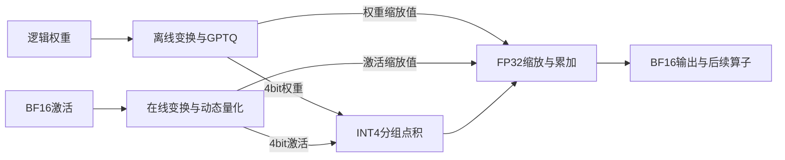

# 核心实现：量化、并发执行与调度

优化从客户端延迟出发。旧基线增大并发后，总吞吐增长有限，生成延迟却明显上升。长输入处理、大矩阵执行、生成验证和状态管理共享单卡资源，需要同时减少计算开销并协调请求之间的竞争。

## 1. 让4bit参与真实矩阵计算

### 设计

仅缩小权重文件不保证推理更快。我们的主线是**W4A4**：指定矩阵路径的权重与激活都编码为4bit，调用S4整数矩阵指令，再用浮点缩放恢复结果。

离线阶段从经过核验的FP8逻辑权重及scale出发，使用局部Hadamard变换、分组和GPTQ校准。在线阶段对激活执行对应变换与动态量化。对于列向量，未量化时 `x′=Rx, W′=WRᵀ` 且正交R使 `W′x′=Wx`；量化之后仍有近似误差。



采用H512变换与G512分组；缩放、SiLU和残差等保留实际计算语义。变换不能随意跨越非线性层和递推状态，Norm、KV及状态也不宣称全4bit。

H512表示512维局部Hadamard变换，G512表示每512个输入通道一组。组内用有符号4bit矩阵指令得到INT32点积；各组乘以对应的权重与激活缩放因子，再按原计算顺序做FP32累加，最后写回BF16。离线缓存和在线算子必须使用同一变换、分组与缩放约定，不能只替换权重存储格式。[已有S4实现](../../results/three-node-optimization/ucloud2/true-int4-community-implementation-032/private_gptq_s4_pipe4.cuh)保留了整数矩阵指令和分组缩放路径。

### 覆盖与验证

第一阶段校准前馈网络64层的gate/up与down，共128个矩阵；之后增加输入与输出投影。校准使用六条固定8192-token WikiText请求，四条训练、两条留出，未使用IFBench答案。FFN留出诊断中，64/64 gate及63/64 down优于固定minmax，down第3层更差，保留该结果。[校准报告](../../results/three-node-optimization/ucloud2/true-int4-all-layer-GPTQ-025/REPORT.md)包含参数和误差明细。

验证分三层：检查量化码、scale及整数点积；检查完整算子中的缩放、非线性和BF16舍入；再检查真实模型路由、状态与任务输出。算子计时包含变换、量化和写回，避免只报告整数点积的局部速度。符合量化公式不等于与高精度模型无损。

输出投影量化版完成12并发性能测试。后续把47层GDN输出投影的部分验证形状也接入S4，形成“验证阶段扩展版”：仅T33–128启用，T1–32、L0和16个全注意力输出投影保留原路由。该版本T64/T128完整算子局部速度为参考路径的2.25/2.90倍，整服务16并发仍未达标；其独立IFBench质量为84/100。[实现与原输入范围](../../results/three-node-optimization/ucloud1/output047-verify-integration-076/REPORT.md)和[实际任务质量](../../results/three-node-optimization/ucloud2/outputVerify-K3-C16-quality-076/REPORT.md)分别保存。

## 2. 多请求执行要同时保证状态正确

把并发上限从8扩到16/32，需要调整attention和GDN几何、投机验证、工作区以及CUDA Graph捕获，HTTP层放行更多请求只解决入口容量。

每个请求分别维护KV缓存、GDN递推及卷积状态、槽位与已提交Token。目标模型验证候选后，输出策略还会结合EOS、stop和剩余生成预算裁定实际提交长度；取消行提交0。因此，候选接受数量与最终提交数量必须分开。

执行顺序为：输出策略预判各行长度 → `resolve_pending_batch`处理各请求的待提交状态 → 更新非取消请求的Token序列、生成预算和解码轮数 → 发布有效输出。部分提交、回滚和槽位复用都要保持上述状态与同一已提交序列对应。实现顺序可在[执行器源码](../../results/three-node-optimization/ucloud3/request-yield-max-to079-handoff-001/delta/src/runtime/engine/concurrent_executor.h)中逐项核对。

扩容涉及attention/GDN执行形状、验证输入输出缓冲、行到槽位映射、状态记录容量和CUDA Graph参数；资源按配置的并发数分配。[Native32交付检查](../../results/three-node-optimization/ucloud3/native-batch32-delivery-001/REPORT.md)实际覆盖B16/B32、非平凡行重排与高槽位、混合0–4提交和两次Graph重放，并核对256B行表和336B参数字段。该检查证明对应算子接口与Graph的正确性，不能代替整模型显存或SLO测试。

两项后续实现体现了这种约束：

| 改造 | 设计目的 | 验证与结果 |
|---|---|---|
| 高批注意力分片 | 降低16/32批执行的中间结果和归并开销 | 算子与真实模型分别检查；局部筛选未全部达到速度门槛 |
| GDN状态折叠与记录融合 | 减少重复处理状态 | 原生模型2013条配对记录无差异，但32并发尾延迟变差 |

状态融合的2013条记录包括1776个层/槽位状态哈希、168个执行/提交、68个预填充及1个快照记录，不是2013项独立测试；该阶段另有86项CTest通过、4项因缺fixture跳过。已验证驻留checkpoint恢复和磁盘快照生成，磁盘restore不在该范围内。[生命周期验证](../../results/three-node-optimization/ucloud3/gdn-fusion-native-lifecycle-001/REPORT.md)保留具体证据。

## 3. 用分块和生成进度安排工作

长输入一次执行会占用GPU，影响已开始生成的请求。服务使用2048-token预填充块，并在块与生成轮次之间调度。完成预算参考首字时限、剩余生成工作和队列约束；是否满足延迟要求仍由客户端计时判断。

后续“生成进度调度改进”进一步考虑单个请求每轮真正提交的token，避免用批次平均产出过度乐观地估计慢请求。实现取原批次剩余轮次估计与逐请求估计的较大值。该改动只更新host调度逻辑，保留模型算子和Graph路径；同机单轮16并发的生成P95从48.784降至45.745毫秒，仍高于40毫秒。[报告](../../results/three-node-optimization/ucloud3/request-yield-max-C16-official128-recovery002/REPORT.md)包含完整请求与配置对照。

逐请求估计的具体实现如下。设`g_i`为已提交Token数（含预填充首Token），`d_i`为有效解码轮数，`r_i`为剩余生成预算，`y_b`为原批次每轮产出估计：

```text
y_i = (g_i - 1) / d_i
R_b = ceil(r_i / max(1, y_b))
R_i = max(R_b, ceil(r_i / max(1, y_i)))
预计剩余解码时间 = R_i × 当前批次轮耗时
```

无有效历史时直接使用`R_b`。计数在输出策略裁决、待提交状态处理和预算提交之后更新，预填充首Token不算解码产出，取消行不增加解码轮数。快请求不会压低原估计；慢请求可提高其剩余工作预算。新请求对象的轮数从0开始，避免槽位复用继承旧请求历史。修改保留原完成时限、批次轮耗时估计、FCFS与预填充期限保护；只在允许选择时影响预填充/解码顺序。[精确补丁](../../results/three-node-optimization/ucloud3/request-yield-max-to079-handoff-001/minimal.patch)包含两个主机端头文件的改动。

我们也尝试提示词查找候选与MTP混合：目标验证窗口为5、MTP提议为3，查找候选仍经过目标验证。混合方案及其调度改进完成正式16并发测试，吞吐达到344.06/346.09 token/s，生成延迟仍超限。它们改变了提议和验证组合，需要各自的任务质量验证，不能继承旧版分数。原始结果见[实验索引](experiment-index.md)。

## 4. 工程验证如何连接到结果

| 层次 | 主要检查 | 能支持的结论 |
|---|---|---|
| 量化与算子 | 码值、scale、数值误差、边界、完整算子耗时 | 局部实现是否正确及有收益 |
| 实际模型 | 真实权重地址、执行路由、状态/回滚、Graph | 接入是否覆盖目标路径且状态一致 |
| 真实服务 | 原始输入、逐请求时序、冷缓存、异常与终态 | 该版本和配置的端到端行为 |
| 完整任务 | 原前100预测、原版评分器、失败题 | 对应配置的IFBench质量 |

项目同时完成了部署/接口适配、固定模型与环境、历史性能筛选和跨框架参照。每个阶段的失败与恢复记录继续保留；实验台账包含CPU检查、算子及模型运行，记录条数不等于独立GPU实验次数。

## 5. 方法来源与贡献边界

基础引擎与MTP来自[NInfer](https://github.com/UDPSendToFailed/ninfer-4090)，校准及变换参考[GPTQ](https://github.com/IST-DASLab/gptq)、[QuaRot](https://github.com/spcl/QuaRot)和[Atom](https://github.com/efeslab/Atom)。团队贡献集中在目标模型的缓存生成、CUDA算子与路由、多请求状态及工作区、调度和测量验证；不把上游方法本身作为原创成果。

参数、完整身份与获取方式见[实验索引](experiment-index.md)和[复验说明](reproduction.md)。性能取舍和没有采用的路线见[性能分析](performance-analysis.md)。
